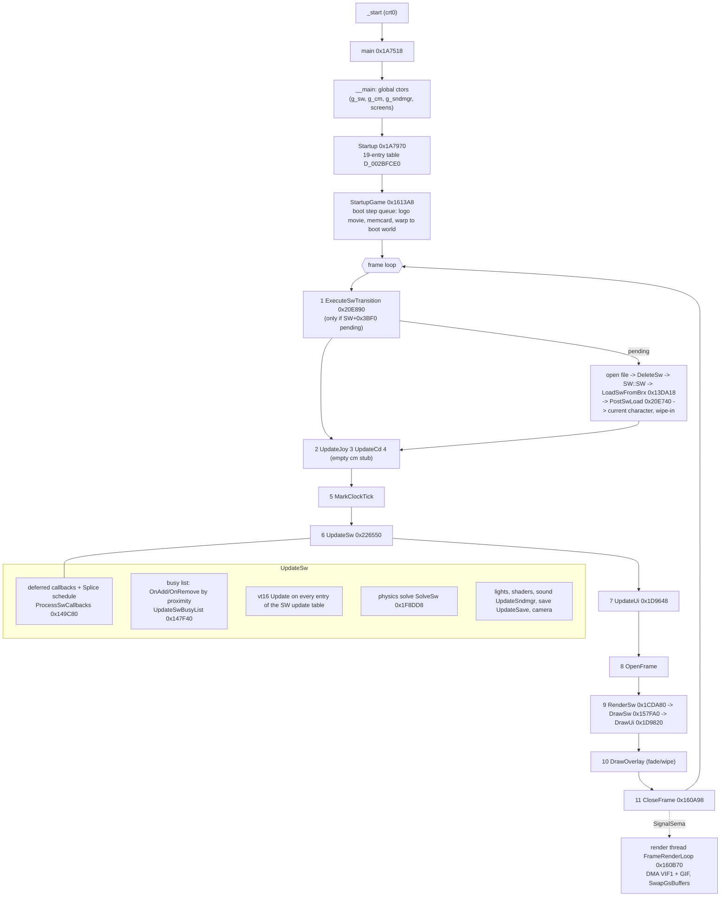

# Engine overview

> v2: for the corrected level-transition order see [world-sw](world-sw.md#2-loading-a-level); for the full render pipeline see [rendering](rendering.md); file formats are now complete under [formats/](../formats/level-objects.md).

The big picture of the Sly 2 engine, in the order the machine runs it: boot, the frame loop, the level
lifecycle, the object model, then the per-frame update and render, and a map of the subsystems.
Tags are explained in the [README](../README.md#how-knowledge-is-marked).

## 0. The shape of the program

- One statically linked EE executable, `SCUS_973.16`: game code 0x100000-0x2319E8, Sony's 989snd client
  library 0x2319E8-~0x233130, Sony SDK libraries above 0x233000 `[C:static]`.
- Game code is C++ compiled by ee-gcc 2.95.3 (`-O2 -G0 -ffast-math`) and linked **in alphabetical file order**
  after a core block (crt0, Splice thunks, class factories, core library, Splice runtime) `[C:static]`. That order
  is how most file names in [reference/tu-map.md](../reference/tu-map.md) were recovered `[H]`.
- Almost every source file (translation unit, TU) ends with two compiler stubs that register the Splice
  slot-heap pools: `__static_initialization_and_destruction_0` + `_GLOBAL_$I` (`f(1,0xFFFF)`), and files with
  global destructors have a third, `_GLOBAL_$D`. 209 such boundaries split the code into ~210 TUs `[C:static]`.
- The design descends from Sly Cooper 1 (same vocabulary: LO, SO, SW, CM, BRX, Splice, ...), but the object
  model was rebuilt with real C++ classes and virtuals, every class ID was renumbered, and most structs changed
  layout `[C:static types/README]`. Sly 1 is a source of **names**, not of offsets.

## 1. Boot

`_start` (crt0) -> `main` 0x1A7518 `[C:static]`:

| Step | What | Address | Tag |
|---|---|---|---|
| 1 | `__main()` runs C++ global constructors (this constructs `g_sw`, `g_cm`, `g_sndmgr`, the screen objects, ...) | 0x23B7D8 | [C:static] |
| 2 | store `argc/argv` | D_002E2050/54 | [C:static] |
| 3 | `Startup()`: run the 19-entry startup table D_002BFCE0 under a CProg progress bar, ticking the clock between entries | 0x1A7970 | [C:verified] |
| 4 | `StartupGame()`: language from `sceScfGetLanguage`, game event 0 (startup), start the boot step queue (logo movie, memcard check, warp to the boot world) | 0x1613A8 | [H r3b game.md] |
| 5 | enter the frame loop (forever) | | [C:static] |

The startup table, in order `[C:static]` for the table, names `[H r4 main.md]` where marked `?`:

| # | Entry | | # | Entry |
|---|---|---|---|---|
| 1 | StartupDma 0x157200 | | 11 | ? 0x1C90D0 (loading-screen thread, `StartupLoadingScreen` [H r5 prog.md]) |
| 2 | StartupThread? 0x21F100 | | 12 | StartupClock? 0x14CFE0 |
| 3 | StartupSif 0x1A7630 (IOP modules, `ioprp300.img`) | | 13 | StartupVU0 0x1A7890 |
| 4 | StartupGs 0x1700D0 | | 14 | StartupVU1 0x1A7900 |
| 5 | StartupMemMgr 0x1AE168 | | 15 | StartupSound? 0x1FCEA0 |
| 6 | StartupCd 0x14BA30 | | 16 | StartupBlips? 0x138FC0 |
| 7 | ? 0x14B660 (CD/file helper) | | 17 | ? 0x211528 (GIF packet setup; Sly 1 StartupScreen analog) |
| 8 | ? 0x15EF00 (`StartupFont` [H r3 font.md]) | | 18 | StartupMemcard 0x1AA978 |
| 9 | StartupJoy 0x187030 | | 19 | StartupMpeg? 0x1B2940 |
| 10 | StartupFrame 0x1607A0 (render thread) | | | NULL terminator |

## 2. The frame loop (exact order)

From the matched `main` body (`src/hand/func_001A7518.c`) `[C:static]`; callee names `[H r4 main.md]` unless tagged:

```
for (;;) {
  1  ExecuteSwTransition(g_sw)   0x20E890  if a level change is pending (SetSwTransition): open file, tear down, load, post-load
  2  UpdateJoy(&g_joy)           0x1871C0  pad read
  3  UpdateCd()                  0x14BA38  disc check / CD service
  4  SetupCm(&g_cm)              0x14D470  EMPTY in Sly 2 (Sly 1 SetupCm call site kept) [C:verified arbitration]
  5  MarkClockTick(&g_clock, 0)  0x14D0B8  dt from the EE cycle counter, clamped to [1/60, 1/30] s
  6  UpdateSw(g_sw)              0x226550  the world update (section 5)
  7  UpdateUi(D_003D9E70)        0x1D9648  pause / menus / memcard UI
  8  OpenFrame()                 0x160828  start building this frame's DMA chains
  9  if (!g_pOverlay || overlay allows render)          D_002DD644, 0x1477B0
        RenderSw(g_sw)           0x1CDA80  vt19 RenderSelf on visible objects; bumps SW+0x3D60
        DrawSw(g_sw)             0x157FA0  sort the render list, emit the VIF1 chain with pass hooks
        DrawUi(D_003D9E70)       0x1D9820  HUD lists + GIF/VIF flush (symbol says UpdateRecyclable__3CGc: wrong)
 10  if (g_pOverlay) DrawOverlay 0x1477D8  full-screen transition sprite pass
 11  CloseFrame()                0x160A98  finalize chains, hand the frame to the render thread
 12  g_cframe++                  D_002BE538
}
```

The render thread (`FrameRenderLoop` 0x160B70, started by StartupFrame) waits for a closed frame, DMAs its VIF1
then GIF chains, optionally blends the previous frame, and swaps GS buffers, so the CPU builds frame N+1 while
the GPU draws frame N `[H r3 frm.md]`. `g_cframe` and SW+0x3D60 both advance exactly once per frame (2510/1961/576
frames between consecutive save states) `[C:runtime]`.



## 3. World / level lifecycle

There is exactly one world object, `g_sw` (class SW, CID 0x1, 0x4790 bytes, a static at 0x3DD490) `[C:runtime]`.
It owns every pool, object list and hash table of the level. Loading a level reuses the same memory:

| Phase | What happens | Where | Tag |
|---|---|---|---|
| Request | Something (a warp/exit volume, a task, the boot queue, a death) fills the pending request at SW+0x3BF0 (world record, oid, key) | WipeToWorldWarp 0x22B490, ... | [H r7 sw.md] |
| Teardown | `ExecuteSwTransition`: FlushFrames (drain the render thread), game event 1, `DeleteSw` 0x20E068, `memset(g_sw)`, `SW::SW` 0x20D9D0 again; the world heap is reset (`FreeSw`) | 0x20E890 | [H r7 sw.md] |
| Open | the world file's FILEREC -> sector range; a CD-backed binary input stream with LZSS decompression into a scratchpad window | 0x20E890, 0x1179D8 | [C:static disc_toc.md] |
| Load | `LoadSwFromBrx`: world-entry (proxy source) table, sound section, save-variable schema, level table, localized strings, cell BSP, options of g_sw and g_cm, then per world entry: Splice refs, textures/shaders, the object list (each object `c8` times) | 0x13DA18 | [C:static], [C:verified samples] |
| Create | per object `PloNew(cid, parent, oid, isplice)`: factory, link into oid hash + class list, vt7 Init, vt11 AddHierarchy, vt23 OnAdd if live; then vt14 LoadFromBrx consumes the object's bytes | 0x13E3C8, 0x13FB40 | [C:static] |
| Post-load | `PostSwLoad`: drain the post-load callback queue, vt15 PostLoad on objects, bind save vars, current character (`oidPoCurrent`), game events 4/5 (no checkpoint record exists: a death reloads the level) | 0x20E740 | [C:static], [C:runtime S29-S30, S56] |
| Run | the frame loop; objects become live/inactive by proximity (section 4) | | |

Level identity: 44 levels (9 worlds intro..blimp, each with a hub "episode 0" level) are listed in a level table
carried by every world file; the current level index is D_003E1110 (2 = the Paris hub "nightclub/exterior" in the
save states) `[C:runtime]`.

## 4. Object model

```
BASIC (0x0)                               vptr at +0xC; slots 1-6: refcount hooks, Splice event, messages, Pclassinfo
 ├─ SW (0x1)                              the world (not an LO in Sly 2)
 ├─ CM (0x87), SAA family, POCTL, ASEGA, SMA, BHV (0x9B) + 43 behaviours, screens, ...
 └─ LO (0x2) level object, 48 slots       oid, parent, hierarchy, Splice frame, busy/activation, options
     ├─ XFM (0x3) LO + own matrix         44 lightweight classes: LIGHT, PROXY, SHAPE(PIPE, RAIL..), TN, TARGET, VOL, EMITTER, ...
     ├─ ASEG, SM, WR, WIDGET (HUD), JOB/TASK (0x84/0x85), ...
     └─ SO (0x30) solid object, 75 slots  XF array, collision parts, physics record, model (GLOBSET), zaps, fading
         ├─ MS, BOMB/MISSILE, BARRIER, RIPG, ALARM, pickups (DPRIZE family), ...
         └─ PO (0x32) playable object     POCTL controller, HP/MP, active-character switching
             └─ STEP (0x33) walker         heading/turn, ground contact, behaviour stack (BHVSTK)
                 ├─ STEPPLAYER (0x34)      8 embedded components (air, grab, places, hurt, mode, pipe, goal, throw), gadgets
                 │    ├─ JT (0x35) Sly       ├─ MURRAY (0x36)       └─ BENTLEY (0x37)
                 └─ STEPGUARD (0x38)       perception, flags, engagement; GOMER (0x39) + 10 subclasses
```
(CIDs in hex. Tree from the descriptor table D_002BAAE8 `[C:runtime]`; identifications in [class-tree](../reference/class-tree.md).)

Key facts (details in [object-model.md](object-model.md)):
- **Classes are data-described.** D_002BAAE8 holds 199 records `{super, cid, cidMax, cb, pfnNew}`; `cidMax` makes
  "is derived from" a range test; vtable slot 6 returns the record `[C:runtime]`.
- **Virtual slots are stable across the LO family**: 3 HandleSpliceEvent, 4 SendMessage, 5 HandleMessage,
  7 Init, 8 Add, 9 Remove, 10 SetParent, 11 AddHierarchy, 12 RemoveHierarchy, 14 LoadFromBrx, 15 PostLoad,
  16 Update, 17 ProjectTransform, 19 RenderSelf, **22 OnRemove, 23 OnAdd**, 25 SetIdProxy, 40 CloneHierarchy,
  41 Clone `[C:static]`/`[C:verified]`. So naming a subclass's Init/Load/Update is mechanical.
- **Messages vs Splice events.** Slot 4 `SendMessage` delivers a numeric message to the object's own slot 5 and
  to every subscriber (a refcounted list at BASIC+0x8). Slot 3 `HandleSpliceEvent` looks up a script binding for an
  event symbol in the object's Splice frame and runs (or schedules) the script. `vt3(k,0,0,0,0)` calls are Splice
  events (5 = trigger, 6 = untrigger, ...), not messages `[H r2b basic.md]`.
- **Live vs loaded.** An object can be in the world but inactive. `FIsLoInWorld` = in-world bit 60 of +0x28 **and**
  its root (LOROOT) in the active-roots list `g_sw+0x2C`. Slot 23 OnAdd fires when that becomes true, slot 22
  OnRemove when it becomes false, both on structural changes and on proximity changes every frame. Only live
  objects are in the SW update table, so only they get Update/RenderSelf `[C:verified arbitration]`. Guards and
  pickups are pooled and toggled in and out this way, never freed `[C:runtime]`.

## 5. Per-frame update and render

`UpdateSw` 0x226550 (once per frame, if dt > 0) `[H r8 update.md, r4 main.md]`:
1. deferred SW callbacks and due Splice scheduled callbacks (`ProcessSwCallbacks` 0x149C80) `[H r2b callback.md]`;
2. the busy list: re-evaluate which roots are near the player/camera; OnAdd/OnRemove (`UpdateSwBusyList` 0x147F40) `[C:verified]`;
3. vt16 `Update` on every live object in the SW update table (array at SW+0x3F20, back-pointer in LO+0x40) `[C:runtime]` for the table;
4. world sub-lists (ASEGA animation applications, noise stimuli, ...), physics `SolveSw` 0x1F8DD8 `[H r7 solve.md]`;
5. lights, shader animation (`UpdateShaders`), zap history expiry, then always `UpdateSave`, `UpdateSndmgr` 0x1FD830,
   camera update and the HUD stack (0x20F7E0) `[H r4 main.md]`.

Render: `RenderSw` 0x1CDA80 calls vt19 `RenderSelf` on live objects with the render flag; objects push 16-byte
render-list entries (RPLs: kind, z, two DMA CALL addresses). `DrawSw` 0x157FA0 bucket-sorts them into 26 kinds,
maps kinds to 12 passes (D_002BDD20 -> D_002BDD88) and calls each pass's begin/end hook (VU1 microcode upload,
GS register packets) around the entries' DMA calls `[H r3 draw.md]`.

## 6. Subsystem map

| Subsystem | Page | Core globals / entry points |
|---|---|---|
| Boot, frame loop, clock, pad | [main-loop-startup](main-loop-startup.md) | `main` 0x1A7518, `g_clock` 0x2DDED0, `g_joy` 0x2DFC00 |
| Object model | [object-model](object-model.md) | D_002BAAE8, `PloNew` 0x13E3C8, `InitLo` 0x1A5270, `PloFindSwObject` 0x15E938 |
| World, load, transitions | [world-sw](world-sw.md) | `g_sw` 0x3DD490, `LoadSwFromBrx` 0x13DA18, `ExecuteSwTransition` 0x20E890 |
| Bosses | [bosses](bosses.md) | boss levels, boss classes, task +0xC0 controlled PO |
| Minigames | [minigames](minigames.md) | hacking, RC vehicles, turrets, dance; controller hand-off |
| Scripting | [splice-scripting](splice-scripting.md) | BIF table D_002BBB90, `RefEval` 0x127838, option table D_002AC880 |
| Rendering | [rendering](rendering.md) | `DrawSw` 0x157FA0, pass table D_002BDD88, `g_vifs`/`g_gifs` |
| Camera | [camera](camera.md) | `g_cm` 0x2DDF40, policy stack CM+0x310 |
| Players | [player](player.md) | `g_pjt` 0x2E1E40, `SetJtJts` 0x18C250, STEPPLAYER vtable 0x2CBE68 |
| Guards | [guards-ai](guards-ai.md) | guard list D_003E1444, BHVSTK at STEP+0x26C, flags STEPGUARD+0x2C0 |
| Progression | [game-progression](game-progression.md) | `g_game` 0x2DEB30, `BroadcastGameEvent` 0x1619A0, JOB/TASK |
| Save | [save-memcard](save-memcard.md) | `g_gs` 0x3D4A60, schema `g_sw+0x3A18`, `g_save` 0x2E65E0 |
| Sound | [sound](sound.md) | `g_sndmgr` 0x3DD040, `PsndStartSound` 0x1FBB90 |
| HUD/UI | [hud-ui](hud-ui.md) | WIDGET (0x7E), STRINGGEN D_003E1C88, screens D_003D9E70 |
| Particles | [particles-effects](particles-effects.md) | EMITTER (0x1D), RIPG (0x57), BLIPG (0x1C) |
| Physics/navigation | [physics-collision](physics-collision.md) | SO, `SolveSw`, `InflictZap` 0x1F7598, pathzones |
| Animation | [animation](animation.md) | ASEG/ASEGA, SM/SMA, XF slots |
| Cutscenes/movies | [cutscenes](cutscenes.md) | RELAY (0x72)/JSG, CMpeg |
| Core library | [core-library](core-library.md) | world/stack heaps, slot heaps, DL/SL, CBinaryInputStream |
| Misc gameplay classes | [gameplay-objects](gameplay-objects.md) | buttons, barriers, bombs, turret, RC car, ... |

## 7. Where Sly 2 differs most from Sly 1 (for readers who know Sly 1 code)

| Area | Sly 1 | Sly 2 | Tag |
|---|---|---|---|
| Classes | C function-pointer VT tables, vptr at +0, ALO class | real C++ virtuals (vptr +0xC), no ALO (split into LO + XFM), SW/CM are BASIC children | [C:static] |
| Activation | OnAdd/OnRemove + separate FreezeAlo | one OnAdd/OnRemove pair driven by structure and proximity | [C:verified] |
| Level file | one object tree, objects without sizes | world entries (proxy sources) instanced `c8` times, every object record carries its byte size | [C:static] |
| Guards | SGS state machine in STEPGUARD | ~43 BHV behaviour classes on a per-character stack; STEPGUARD hosts perception and flags | [C:runtime] |
| Progress | scattered game state | one 0x5400-byte save blob addressed by named variables from a schema in the world file | [C:runtime] |
| Missions | - | JOB/TASK dependency graph + a game event bus | [H r3b game.md], counts [C:runtime] |
| Scripting | Splice | same language, renumbered tags, 169-entry builtin table, RELAY/JSG sequence engine on top | [C:static] |
