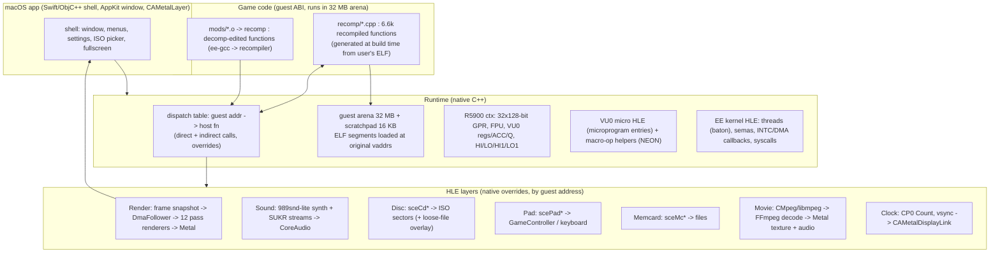
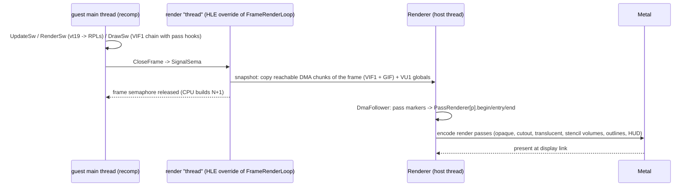

# Sly 2 native macOS (Apple Silicon) port: architecture plan

> A design proposal (not reviewed), kept as a decision record. Its citations name the engine research pages of the
> time (`rendering.md §4`, `sound.md §3`, `overview`, ...): their substance is condensed in [engine.md](../engine.md)
> and the full pages are in git history (`git show 3493d772:docs/engine/rendering.md`); formats are under
> [../formats/](../formats/world-file.md). The render port checklist is section 6.6.

> **Superseded in part (2026-11-10).** The port now lives in a separate private repository that compiles this
> decomp's own sources natively (64-bit, clang) with the decomp pinned as a submodule; it uses SDL3 for window, input,
> audio and GPU (SDL's GPU API on Metal), and verifies behaviour by automated comparison against PCSX2. This
> repository stays matching-only; match-preserving portability fixes still land here. That repository's
> plan folder (inventory, 64-bit hazards, prior art, milestones) is the current plan; the sections below remain as
> background and as a record of the alternatives considered. Section 15 sketches modding with Splice.

Status: proposal v1, 2026-11-01; revised 2026-11-06 with the **[S]** notes (section 14). Author: port-planning agent. Audience: the TL, plus agent teams who will build it.
Evidence tags: **[K]** = known, with a citation to our docs or a measurement made while writing this plan.
**[A]** = assumption or opinion that needs checking (each one is tied to a spike or a task in section 11).
**[S]** = reported by SafeHouse, unverified: a behaviour fact or design idea observed in an independent hand-written
Sly 2 port (section 14). Facts only; that code is all rights reserved, so none of it is read while writing port code.
"Decomp" means this repository.

---

## 0. The decisions, in one screen

1. **Use a static-recompilation spine, and treat the decomp as the source of truth for everything that is edited.**
   Translate every matched function of `SCUS_973.16` (the same bytes the decomp's sources produce, because every
   function matches) into C++ that runs against a 32 MB guest "EE RAM" arena. Replace hardware and SDK code with
   native high-level emulation (HLE) at function boundaries. Do not convert all ~6.6k decomp files to 64-bit C first.
   This is the N64Recomp / Zelda64Recomp pattern. Section 2 explains why it beats the sm64/SotN "compile the decomp
   natively" pattern for this codebase.
2. **Two ways to change game code.** (a) **Native overrides**: C++ written against the guest arena and registered by
   guest address. Use these for HLE layers (renderer, sound, IO) and for hot paths. (b) **Decomp edits**: change a
   decomp source file, compile it with the existing ee-gcc toolchain, and run the resulting object through the same
   recompiler. Use these for gameplay fixes and mods: the code stays readable and there is no ABI bridging.
3. **Rendering: HLE at the render-pass level, not GS emulation.** Keep the game's own render list, its 26 kinds and its
   12 passes. Snapshot each closed frame's VIF1 chain and walk it in C++ (like OpenGOAL's DmaFollower). Decode
   unpacks on the CPU. The six VU1 programs become Metal pipelines: per-vertex work in vertex shaders, event-driven
   relighting in C++ (Metal compute later). Use a real stencil buffer for the shadow volumes. Keep textures in Metal
   as decoded images, keyed by GS address (TBP/CBP). Do not emulate GS local memory.
4. **Sound: a small 989snd-compatible synth plus a SUKR stream player, on CoreAudio.** HLE at the EE-side RPC calls
   (`snd_SendIOPCommand*`, SUKR RPC). The IOP is not emulated.
5. **Platform:** `sceCdRead(lba)` reads straight from the user's ISO, with a loose-file overlay for mods. `scePad`
   maps to GameController.framework. EE threads become host threads that hand one baton between them, so only one
   runs at a time, as on the single-core EE. `sceMc*` maps to files in `~/Library/Application Support/Sly2/`.
6. **The first goal is a frame, not a boot.** M0 renders a Paris frame in Metal from a PCSX2 RAM snapshot, with no
   game code running. We already have the data, `devtools/render_lab` and `vu_microcode/chains.py`. M1, booting
   headless through the recompiled spine, runs in parallel. Both meet at M2: Paris on screen and controllable.
7. **The differential-check harness is an M1 deliverable, not a later test.** Snapshot EE RAM and registers at a
   function's entry and exit, run the candidate (native override, decomp edit, or recompiled code against the original
   in PCSX2), compare. The recompiled spine is the oracle, so every nativized function can be checked from day one
   (section 10; the hand-written port in section 14 found this the thing that made porting tractable **[S]**).

---

## 1. What we know vs what we assume

### 1.1 Known facts that drive the design

| # | Fact | Source |
|---|---|---|
| K1 | All 6,662 functions match byte for byte. `functions.csv` has 6,816 rows; the remainder are dead-code scraps (`config/junk.csv`, 168 entries) plus other non-function rows. I did not reconcile the exact count. | decomp `README.md`; counted while writing this plan |
| K2 | **Data is not decompiled.** Code refers to 2,643 distinct `D_00xxxxxx` globals through ~20k `extern` declarations; only 3 are defined in source. Vtables, class descriptors (D_002BAAE8), pass tables (D_002BDD20/88), strings and `.rodata` jump tables all come from the ELF. | grep over `src/` while writing this plan; MATCHING_NOTES.md:88 |
| K3 | Each function is its own file with ad-hoc struct views (`char pad[0xC]; struct VE *vt; ...`), built on 32-bit pointers and ee-gcc 2.95 vtables (8-byte entries `{short delta; short pad; void *pfn}`, vptr at +0xC). 924 files still use `M2C_FIELD` (2,554 uses). | samples in the pre-merge per-function tree; common_context.md; docs_v2 overview §4 |
| K4 | Inline asm: 790 game files have `__asm__` (5,371 statements). Most are VU0 macro-mode ops (`vmul`, `vsub`, `qmtc2`, `vsqrt`, `vdiv`, ...), MMI (`pextuw`, `prot3w`, `lq`), and ~90 symbol-alias asm labels (`__asm__("func_...")`, which are harmless). 45 files have 20 or more statements. Fully hand-written asm: only 3 game files (crt0: `_start`, 0x100218, 0x100220) plus the hand-written Sony SDK files in `src/sdk`. | grep while writing this plan |
| K5 | Memory map: `.text` 0x100000 (0x159DF0 B), `.vutext` 0x259DF0, `.rodata` 0x262380, `.data` 0x2AC880, `.bss` 0x2DD380 (+0x174E80); second LOAD 0x472200 (0x73C40 B). World heap grows up from `_end`; stack heap grows down from 0x2000000; `malloc` returns NULL and `free` is a no-op. | `readelf`; docs_v2 engine/core-library.md §1 |
| K6 | Boot is a 19-entry startup table (D_002BFCE0). The frame loop is fixed (§2 of overview). A render thread `FrameRenderLoop` 0x160B70 DMAs VIF1 then GIF chains and swaps buffers. Threads: main, render, loading screen (0x1C9190), memcard worker (0x1AAF18), MPEG. | docs_v2 engine/overview.md §1-2; main-loop-startup.md §6 |
| K7 | Rendering is fully characterised: RPL entries `{kind, z, pqwA, pqwB}` in `g_arpl` D_003B3980; 26 kinds map to 12 passes; 7 microprograms (VU0 helpers 84 instructions; VU1 blip 472, HUD 280, cel border 292, projected volume 972, relight 186, main glob 1932). Per-vertex maths, relight formula, outline silhouette test and green-channel Z-fail shadows are all written down. | docs_v2 engine/rendering.md; vu_microcode/MICROCODE.txt |
| K8 | `pqwB` chains are **static, built at load time** (`CopyRelocateDmaChain` 0x169EB8). `pqwA` is rebuilt per instance each frame. Level textures upload once per level (GSB0); class-3 sky textures re-upload every frame into Z-buffer memory. | rendering.md §2, §9 |
| K9 | Display is a field-rendered 512x224 CT32 double buffer, Z32, and Z is "bigger = nearer". | rendering.md §1, §5 |
| K10 | The clock reads the CP0 cycle counter (1/294.912 MHz) and clamps dt to [1/60, 1/30] s. Game time is scaled by 9 rate slots. | main-loop-startup.md §2 |
| K11 | Disc access goes only through `sceCdRead`, via the retry wrapper `ReadCdDirect` 0x14BC78. World files are LZSS streams opened by FILEREC sector range. | core-library.md §4; disc_toc.md |
| K12 | Sound: per-level 989snd 'SBlk' v3 banks (TONE grains = PS-ADPCM samples with ADSR); VPK music/ambience; VAGp dialogue; streams through Sucker Punch's IOP module `spiop.irx` (RPC 'SUKR', commands 0-12). Decoders exist (`[C:parse+decode]`). Open: control-grain semantics, the bank-to-sfx-id join, SUKR commands 0xB/0xC. | docs_v2 engine/sound.md; formats/audio.md §5-7 |
| K13 | Save data is one 0x5400-byte blob `g_gs` plus a schema from the world file. The memcard writes 3 slots (`/BASCUS-97316YAOTWTD!/save%d`, `icon.sys`) through a worker thread and sceMc wrappers. | docs_v2 engine/save-memcard.md |
| K14 | Pad: `UpdateJoy` 0x1871C0; JOY held/pressed at +0x10B4/+0x10B8; Sly 1 `PAD_*` masks; rumble through RUMBLE at +0x10CC. Gameplay reads POCTL, not the pad. | main-loop-startup.md §3 |
| K15 | Ground truth exists: 32 MB EE RAM dumps (S02..S24 and more), PINE live-memory tooling (`pine_harness`, `pine_toolkit`), a WebGL reference renderer (`devtools/render_lab`, with relight validation and shadow and outline toggles), a level viewer, an audio browser with ADPCM decode, a texture browser (PSMT4/8 + CLUT decode). | devtools/*/README.txt; runtime/ |
| K16 | Prior art: **OpenGOAL** intercepts the game's DMA chain, copies it, walks it with a `DmaFollower`, and assigns a C++ "bucket renderer" to each of the game's 69 buckets; its direct GIF renderer is explicitly "nowhere near a full GS emulation". **N64Recomp** translates each instruction literally into C (`ctx->r4 = ADD32(ctx->r4, 0X20)`), uses a decomp or disassembly for function metadata, and patches by linking replacement functions ahead of the generated ones. **PS2Recomp** applies this to the R5900 (MMI + VU0 macro support, HLE stubs and per-game overrides bound by address); its GS/VU are stubs and slow. **SotN** port notes: pointer-size changes break any struct with pointers, and the scratchpad needs host storage. | [OpenGOAL graphics docs](https://opengoal.dev/docs/porting-info/graphics), [N64Recomp](https://github.com/N64Recomp/N64Recomp), [PS2Recomp](https://github.com/ran-j/PS2Recomp), [sotn-decomp PC port wiki](https://github.com/Xeeynamo/sotn-decomp/wiki/PC-Port) |

### 1.2 Assumptions (each one has a spike or a task)

| # | Assumption | Check |
|---|---|---|
| A1 | Recompiled MIPS code of a 294 MHz game runs far below frame budget on M-series hardware, even with literal per-instruction translation and arena-relative loads. | T3/T5: time a headless frame |
| A2 | The PS2 FPU's differences from IEEE matter in only a few places. The PS2 FPU has no denormals, NaN or Inf, clamps to ±max, and rounds toward zero; VU0 behaves similarly. ARM FPCR gives us flush-to-zero and round-toward-zero modes; clamping has to be emulated where it matters. Supported **[S]**: host IEEE with `-ffp-contract=off` plus EE semantics at known spots was enough for a hand port (seeds in 4.2). | T8: differential tests on physics and camera functions against RAM snapshots, starting from the 4.2 seeds |
| A3 | macOS arm64 will not let us map guest RAM at host address 0 (the 4 GB `__PAGEZERO` rule for arm64 processes), so guest addresses are offsets from a base register. This costs one add per access. | T2 spike (5 min to try `-pagezero_size`; design does not depend on it) |
| A4 | The game uses no self-modifying code and no runtime code loading. There are no overlays: the ELF is one static image (K5). | recompiler coverage report (T3) |
| A5 | Every indirect jump target is a function entry (vtables, function pointers, Splice BIF table D_002BBB90) or a `.rodata` jump table that the recompiler can find statically. | T3: log and fail hard on an unknown target |
| A6 | PSS FMV is MPEG-2 video with PS2 ADPCM audio. AVFoundation will not decode it, so we need FFmpeg (LGPL, dynamically linked) or an offline transcode at install time. | T19 |
| A7 | ~~Game logic is robust to frame rates above 60 Hz.~~ **Resolved by design (4.4)**: logic always steps at 1001/60000 s and only presentation is interpolated, so the dt clamp (K10) is never lowered **[S]**. | M5: check the interpolation set is enough |
| A8 | No game code reads back GS memory, except the shadow and blend passes we replace, plus possibly the item-preview render-to-texture (CID45, kinds 15-20). | T13 (RTT) and T16 |

---

## 2. Options considered (and why recomp-first)

| Option | What it is | Prior art | Verdict for Sly 2 |
|---|---|---|---|
| **A. Compile the decomp natively (64-bit)** | clang compiles every decomp file for arm64 and a shim replaces the SDK | sm64 PC port, SotN PC port | **Not first.** K2 (no data), K3 (32-bit ad-hoc structs in ~6.6k files, hand-rolled vtable calls), K4 (5.4k inline asm statements) make it a rewrite of the whole codebase before the first pixel. SotN's own wiki lists exactly these failure modes. Possible later, function by function (section 5.4). |
| **B. Native with 32-bit guest pointers** | like A, but every pointer field becomes `gptr<T>` (a u32 offset) and data loads from the ELF at the original addresses | OpenGOAL C kernel `Ptr<T>` | Good end state for hand-tuned subsystems. It still needs per-file rewrites, so it is used for **overrides**, not wholesale. |
| **C. Static recompilation spine + HLE** | translate MIPS to C++ against a guest arena; replace hardware and SDK functions by address | N64Recomp, Zelda64Recomp, PS2Recomp | **Chosen.** Game logic is correct by construction (it is the matched bytes). All the work goes where it has to go anyway (GS/VU, sound, IO). The decomp supplies boundaries, names, types and an editable source path. |
| D. Embed an emulator core (PCSX2 libretro) | wrap an emulator | many | Not a port: no Metal renderer, no modding, no native performance. Rejected. |
| E. OpenGOAL-style new language | n/a | OpenGOAL | Sly 2 is C++; nothing to gain. |

Why C is safe *here* in particular. We know every function boundary (`functions.csv`, `matched.csv`). There is one
compiler at one setting (ee-gcc 2.95.3 `-O2 -G0 -ffast-math`, K1) plus 185 SDK asm files that we replace anyway. The
image is static (K5). We already have byte-level knowledge of every hardware touchpoint: the render pass hooks
(rendering.md §4), the 989snd and SUKR RPC calls (sound.md), sceCd/sceMc/scePad. The literal-translation downside
(unreadable output) does not matter, because readability comes from the decomp itself.

---

## 3. Layered architecture



Per-frame data flow (it mirrors K6):



### 3.1 Repository layout

The port lives in the fork alongside the matching build, and the matching build stays untouched:

```
port/
  CMakeLists.txt          # target sly2_port (arm64 macOS); never touches the matching flow
  recomp/                 # Python generator (rabbitizer-based); output goes to build/gen/, NEVER committed
  runtime/                # arena, ctx, dispatch, kernel HLE, VU0, FPU helpers
  hle/{gfx,snd,cd,pad,mc,mpeg,clock}/
  include/port/           # port-facing typed views of engine structs (shared with decomp headers, see 6.2)
  shaders/                # Metal (.metal), compiled with xcrun metal at build time
  app/                    # macOS shell, Info.plist, icons (no game data)
  tests/                  # differential + golden-image tests; data paths come from env, never in git
```
Legal hygiene **[A]**: generated recompiled code, decoded assets and golden images are all derived from the game.
They stay in `build/` or under the user's data dir and are never committed. This is the same policy the devtools
READMEs already state for their `out/` dirs.

---

## 4. Runtime core

### 4.1 Guest memory model **[K5, A3]**
- Reserve 64 MB of host VM. The first 32 MB is EE RAM: load the PT_LOAD segments of the ELF at their vaddrs and zero
  `.bss`. Scratchpad gets 16 KB of storage at a fixed alias (guest 0x70000000 maps to a separate buffer; the decomp
  touches 0x70000000 directly, K4 grep). Hardware-register ranges (0x1000xxxx, 0x1200xxxx: 24+ literal uses in the
  decomp, mostly 0x10000000 timers and 0x12001000 GS CSR) trap to an MMIO handler table in debug builds and are
  inlined as HLE reads in release builds.
- Access: `mem.u32(addr)` compiles to `*(u32*)(base + (addr & 0x1FFFFFFF))`. Mask off KSEG and uncached aliases
  (0x20000000, 0x30000000) the same way. Both machines are little-endian, so there are **no byte swaps**.
- Guest pointers inside native override code: `gptr<T>` (a u32 wrapper with `operator->`, `get()`, and assignment
  from a host `T*` that asserts the pointer is inside the arena). This keeps native structs layout-identical to the
  PS2 (K3) and lets `static_assert(offsetof(...))` check them.

### 4.2 Recompiler (port/recomp) **[K1, K4, A4, A5]**
- Input: ELF + `functions.csv` + `junk.csv` + `symbol_addrs.txt` + `master_names.csv` (for readable C++ symbol
  names). Decoder: rabbitizer, which the decomp already depends on and which knows the R5900 (MMI, COP2 macro).
- Output: one C++ file per TU (`tools/layout/units.csv`, ~210 TUs). This keeps builds incremental, which N64Recomp also
  found necessary. Literal translation: `ctx->gpr[r]` is 128-bit (u64 low half plus u64 high half), branch delay
  slots expanded, branch-likely, HI/LO plus HI1/LO1 (`mult1`/`div1`), `madd`, MMI ops as small inline helpers,
  `lq`/`sq` 16-byte aligned, `ldl`/`ldr`/`sdl`/`sdr`, `sync`/`ei`/`di`/`cache` as no-ops, `syscall` calls into
  kernel HLE.
- Calls: `jal X` calls `DISPATCH(X)(ctx, mem)` through a **patchable table** indexed by (X-0x100000)>>2, so that an
  override also applies to direct calls. `jalr` and `jr` (not `$ra`) go through the same table; a miss is a hard
  error that logs the guest PC (A5). Jump tables: resolve `.rodata` tables statically into C `switch` statements.
- FPU: emit helpers (`fadd_ps2`, ...). Mode `exact` clamps and flushes; mode `fast` relies on FPCR FZ+RZ. Default
  to `exact` until T8 shows `fast` is safe (A2). Native overrides and the host build use IEEE with
  `-ffp-contract=off` (no fused multiply-add, which the EE never does) and EE semantics only where a test needs them.
  **T8 seeds**, spots where host IEEE visibly broke a hand port **[S]**: round toward zero for animation event times
  and for curve and rope integration; divide by zero gives ±FLT_MAX; multiply and add saturate instead of reaching
  Inf; denormals flush to zero in guard pursuit.
- COP2 macro ops: an emulated VU0 register file (`vf[32]` as float32x4, `vi[16]`, ACC, Q, P, MAC/status flags only
  where read) using NEON intrinsics. `vcallms`/`vcallmsr` into the VU0 microcode (start of `.vutext`, 84 instructions; the 0x1C0
  sphere-visibility routine and matrix/point helpers, rendering.md §4) are HLE'd as hand-written C++ per entry point,
  checked against a tiny VU0 micro interpreter in tests (we already have the decoder, vu_microcode/vudis.py).

### 4.3 Kernel and threads **[K6]**
- Implement the EE kernel calls the game uses (CreateThread, StartThread, Sleep/WakeupThread,
  RotateThreadReadyQueue, CreateSema/WaitSema/SignalSema/PollSema, iSignalSema, AddIntcHandler/EnableIntc,
  AddDmacHandler, SetAlarm, FlushCache) at the libkernel function level (`src/sdk`), not at syscall level, wherever a
  matched wrapper exists.
- Each guest thread is a host thread with its own `ctx`. One **baton** (mutex + condvar, with priority-ordered
  handoff) means only one guest thread runs at a time, and switches happen only at blocking kernel calls or rotates.
  This reproduces single-core EE semantics without auditing game data for races. Interrupt handlers (VIF1 INTC 5 →
  0x167F78 relight readback; vsync) run as deferred callbacks on the thread that holds the baton, at the next kernel
  call or loop-head poll.
- `FrameRenderLoop` is overridden (section 6). `LoadingScreenThread` and `MemcardThreadMain` run as recompiled guest
  code under the baton.

### 4.4 Timing **[K10, S]**
- Game logic always steps at a **fixed 1001/60000 s** (NTSC field rate). The guest clock (CP0 `Count`) advances by
  exactly one step per guest frame, so `MarkClockTick` works unmodified and sees the dt it expects (K10). Input is
  read once per step.
- Pacing: a **real-time accumulator, capped** (a few steps) so a stall does not trigger a catch-up spiral, decides how
  many guest frames to run per display-link callback. At 60 Hz or below this is exactly the PS2 behaviour.
- Above 60 Hz: **interpolate only camera, group (object) and bone matrices** between the last two steps; everything
  else is drawn from the latest step. This resolves A7 without touching game logic **[S]**. The interpolation needs
  the previous step's matrices, which the frame snapshot (6.1) can keep.

---

## 5. HLE layers (non-graphics)

### 5.1 Disc → host files **[K11]**
- Override the SDK `sceCdRead`/`sceCdSync`/`sceCdGetDiskType`/`sceCdInit`/`sceCdMmode` family. Reads come straight
  from the user-supplied ISO (2048-byte sectors), so FILEREC LBAs work untouched. `UpdateCd` 0x14BA38 (per-frame
  disc-check CRC) gets real sectors and so needs no patch.
- **Loose-file overlay** for modding: an LBA-range → host-file map built from `assets/manifest.json`-style records
  (lba/size/fid). When a range has an override file (for example an edited, re-LZSS'd `.brx`), serve from it.
  Larger-than-original files need a virtual LBA allocator above the disc end. The FILEREC table in the ELF data then
  gets patched at load time, which is easy because data is in the arena.
- `StartupSif`'s IRX loading (`ioprp300.img`, 9 embedded modules) becomes a no-op that reports success.

### 5.2 Pad → GameController **[K14]**
- Override `scePadInit/PortOpen/Read/GetState/Info*/SetActDirect` (libpad in `src/sdk`). Build the 32-byte DualShock
  2 report (buttons, 4 analog axes, pressure bytes) from `GCExtendedGamepad`, plus a keyboard mapping. Rumble comes
  from `SetActDirect`, through `GCDeviceHaptics`. The game sees "DualShock ready" (joys ≥3, joyk 3), so
  `SetJoyJoys`/`InitRumble` paths run unmodified.

### 5.3 Memory card → files **[K13]**
- Override `sceMcInit/GetInfo/Open/Read/Write/Close/Mkdir/Delete/GetDir/Format/Sync`. Use a directory per virtual
  card under `~/Library/Application Support/Sly2/mc0/BASCUS-97316YAOTWTD!/` with `save0..2` and `icon.sys`. Keep the
  game's own save format: byte-compatible with PS2 saves, so PCSX2 `.ps2` card import becomes a small tool.
  `sceMcSync` returns immediately with success. The worker thread still runs, so UI flow is unchanged.

### 5.4 Native overrides of game functions (when, and how)
- Mechanism: `PORT_OVERRIDE(0x1FBB90, CreateSfxSound)`. A generated adapter unpacks `a0..a3`, `t0..t3`, `f12..f19`
  from `ctx` per the signature taken from the decomp header and stores `v0`/`f0` on return. Signatures come from
  `include/port/*.h`, which are generated from decomp declarations (6.2).
- Use overrides only at hardware boundaries, for hot spots found by profiling (A1), and for host features
  (widescreen FOV in `BuildStereoEyeViewProj`, a debug camera, a level-select).
- Every override has a **differential test**: run the recompiled original and the override on the same arena
  snapshot and args, then compare arena diffs and return values (section 10).

### 5.5 IOP responsibilities (what replaces the IOP)
There is no IOP emulation. These are the EE-visible IOP services and their replacements:

| IOP module (K12 list) | EE-side entry | Replacement |
|---|---|---|
| cdvdman/cdvdfsv (in ioprp300) | sceCd* | 5.1 |
| sio2man + padman | scePad* | 5.2 |
| mcman + mcserv | sceMc* | 5.3 |
| libsd + 989snd | `snd_SendIOPCommandNoWait/AndWait` 0x232838/0x2325E0, `snd_PostMessage` | 6.4 synth (command ids from sound.md §3) |
| spiop ('SUKR') | sceSifCallRpc on 'SUKR' (STREAMSND, commands 0-12) | 6.4 stream player |
| lgaud, usbd | headset (`fUseHeadset`) | stub "not present" |
| SIF RPC itself | sceSifInitRpc/BindRpc/CallRpc/CheckStatRpc | RPC router: dispatch by server id to the HLE servers above; async calls complete at the next poll |

---

### 5.6 Platform notes **[S]**
Observations from the hand-written port (section 14), to check against our own design:
- **Disc**: it converts the disc once at install time, with mods overlaid by path. Our 5.1 reads the ISO directly with
  an LBA overlay; an install-time unpack is the alternative if path-based mods matter more than zero-setup.
- **Saves**: PS2 memory-card save blocks (the 0x5408-byte `g_gs` image) load as-is. Consistent with 5.3.
- **Script-callback liveness**: Splice callbacks can fire on freed objects; harmless on PS2, a crash natively. A
  recompiled spine reads freed arena memory the same way the PS2 did, so this mainly bites native overrides; they need
  liveness checks.
- **HUD**: drawn on a 640x448 4:3 canvas, then placed on the wide screen (input to the M5 HUD anchor).
- **Stream audio**: streamed audio (music, dialogue) plays at half the 989snd output level (input to T18 mixing).
- **macOS graphics**: macOS OpenGL stops at 4.1. A GL 4.3 renderer needs a translation shim on Metal; the options are
  a GL- or Vulkan-on-Metal layer (for example MoltenVK) or a Metal- or Vulkan-native renderer. This plan already
  targets Metal directly (decision 3).

## 6. Rendering → Metal

### 6.1 Interception point **[K7, K8, K16]**
- Override `FrameRenderLoop` 0x160B70, `RenderFrame` 0x160C80 and `FlushFrames` 0x160E68. When a frame is closed,
  copy what the renderer needs: walk the VIF1 chain from the FRM, recording the arena ranges reached through
  CALL/REF/RET (the static `pqwB` chains are long-lived, K8, so do not copy them: cache by address plus the level-load
  generation). Then release the semaphore. This is OpenGOAL's chunked-copy idea scaled to a 32 MB arena.
- **Pass markers**: the pass begin and end hooks (`g_arpk` D_002BDD88: 12 pairs) are known functions. Override each
  one to call the original *and* append a 2-qword VIF NOP pair carrying a magic marker plus the pass and kind ids.
  The renderer's DmaFollower then switches PassRenderers on markers, exactly like OpenGOAL's bucket renderers. The
  game's sort, kinds and pass order stay authoritative (rendering.md §3: "the main extension point").
- VIF decoding in C++: UNPACK (V2_16, V3_16, V4_32, V4_8, V4_5, S_8 masked, ...), STROW/STMASK/STCYCL, BASE/OFFSET,
  MSCAL/MSCNT (that is, the "run program at entry X" event), DIRECT/DIRECTHL (GIF packets for the GS-state renderer).
  This gives a simulated VU1 data memory (1024 qw) per batch. The PassRenderer reads batch headers from it (MEM 0-0xD
  plus material blocks, rendering.md §5) and produces Metal draws. No VU1 instruction is executed in the shipping
  renderer. A VU1 interpreter exists only as a test oracle (T12).

### 6.2 Which VU programs become what

| Program (pass, kinds) | Where the work goes | Why |
|---|---|---|
| **main glob, A family** (P0/P3/P8-P11; kinds 1,3-6,10,11,13-25) | CPU: unpack to a vertex buffer `{pos xyz, Wflag, st, colour0, colour1}`. Cache it per static chain address (`pqwB`), so it is decoded once per level. GPU vertex shader: `clip = M*p`, perspective-correct ST, fog `F` from the fit params (MEM[9]), fade (params.x). Material layers become a pipeline state per {TEST, ALPHA, FBA, FOGCOL}: layer 0 opaque, layer 1 additive `Cs*As+Cd`. | Static per level (K8). The maths is pure per-vertex (rendering.md §5). |
| **main glob, B family** (skinned, morph, billboard, UV scroll, rim alpha, ≤4 dynamic lights, two-sided flip) | Vertex shader with function constants per stage flag (MEM[0xB]). Per batch: 4 skin matrices, morph deltas, light block in an argument buffer. | Data-parallel; the stage flags map one-to-one to specialised shaders. |
| **relight** (P4, kind 0; no XGKICK) | **CPU C++ first**, writing RGBA5551 colour A/B into the glob colour buffers in the arena, exactly as `StoreRelightColors` 0x167E58 would. Later: Metal compute with readback. | The game consumes the results from EE memory (K7: the INTC 5 readback). It is event-driven (0-12 per frame) and `render_lab/validate_relight.py` already validates the formula. |
| **cel border** (P1, kinds 9/17/20/24) | Instanced quads: one instance per edge record (4 points). The vertex shader projects them, runs the silhouette test `a*b<0`, offsets ~0.49 px scaled to the output resolution, and discards a failed edge by emitting a degenerate quad. Two pipelines: colour with depth test GEQUAL and no write, then depth-only. | Metal has no geometry shaders. Instancing is simpler than mesh shaders and fast enough (≤~180 edges per object, 29-88 objects per frame, rendering.md §4). |
| **projected volume** (P6/P7, kinds 7/8) | Real **stencil**: Z-fail, kind 7 in bits 0-3 and kind 8 in bits 4-7. Then a full-screen resolve: `type = (s7!=0) | (s8!=0)<<1`, colour and gain from the 3-entry table (g_sw+0x3E64), alpha scaled by the "lit fraction" `128-127u`, which the mesh pass writes into an extra R8 render target. | rendering.md §7 already prescribes this. It drops the CT16 shuffles and the alpha save/restore. |
| **blip** (P2, kind 12) | Vertex shader over particle instances: t = now - birth, curves = coefficient vectors · (1,t,t²), flip-book lookup. The CPU only unpacks. | Per-particle maths is closed-form. |
| **HUD** (P5, kind 21) | CPU decodes to a 2-D sprite batch; one pipeline with ortho projection. | Tiny volume (12-25 entries). |
| **VU0 micro helpers** | CPU C++ (4.2) | Called synchronously by EE code. |
| **GS-direct packets** (clears, frame context, BlendPrevFrame, CID116 tint, background gradient, texture uploads) | The "GS state machine" in the renderer: track A+D register writes (TEX0/1, CLAMP, TEST, ALPHA, FRAME, ZBUF, SCISSOR, FOGCOL, PRIM) and translate SPRITE/strip draws into a generic textured-quad pipeline. Handle image transfers per 6.3. | Same role as OpenGOAL's DirectRenderer (K16); not a GS emulator. |

Notes:
- **Projection**: the screen-space "magic float" viewport constants (VU1 qw 0/1) are ignored. Use `world→clip` (qw 2-5)
  with reversed-Z (Z "bigger = nearer" already matches, K9), hardware culling, and honour the
  double-sided flag (MEM[0xB].x & 0x80). **Near-plane clipping must follow the VU1 program's own clipping**:
  the API clipper broke floors and shadows in the hand port **[S]**; T12's VU1 oracle is the check. The guard-band and the culling marks in the W word only matter for the ADC
  (strip restart) bit: decode it into primitive-restart indices on the CPU.
- **Resolution**: render at drawable size. Shader constants scale outline width and blip sizes from the 448-line
  reference. Field rendering and `BlendPrevFrame` (a frame blend at alpha 0x64/0x80) become an optional "PS2 blur"
  setting that is off by default **[A]**.
- **Colour and fog [S]**: keep vertex and material colours in GS units (0x80 = 1.0) through the shader, converting
  only at output; fog is `F = a + b/x` (the reciprocal fit, matching `FitRecipFunction`); the 8-bit palette index
  swaps bits 3 and 4 (already known: [textures.md](../formats/textures.md), CSM1 storage). The hand port reports the
  shadow tint as a 256-entry table indexed by frame alpha, against our 3-entry table: reconcile in T16. Summary in
  [rendering.md](../systems/rendering.md#13-what-a-port-must-replace).
- **Render-to-texture** (kinds 15-20, CID45 item preview, 128x128): an offscreen Metal target per slot, bound by its
  GS TBP when sampled the next frame (A8).

### 6.3 Textures **[K8, rendering.md §9, formats/textures.md]**
- Intercept uploads at the source. Override `BuildUploadBitmapGifs` 0x1ECC28 / `UploadBitmaps` 0x170730 /
  `UploadPermShaders` 0x1ECE58: call the original (so GS-block allocation and TEX0 words stay byte-identical), and
  also decode each BMP/CLUT record (PSMT4/PSMT8 indices plus CT32 CLUTs) into Metal textures registered under
  `(TBP0, TBW, PSM)` and `(CBP, CSA)`.
- Sampling: the fragment shader samples an `R8Uint` index texture plus a CLUT texture. Keeping the palettes is
  required: SAA shader animations swap CLUTs (rendering.md §9), and the texture browser shows "palette swaps and
  lighting passes" as CLUT variants. A cache of expanded RGBA8 versions keyed by (bitmap, clut) is a later perf
  option.
- Unknown uploads (an IMAGE transfer to a TBP we did not see at load) get a generic decode path (PSMCT32/16/8/4,
  swizzle-free because the source is linear EE memory) plus a once-per-TBP log. Bilinear and CLAMP come from
  TEX1/CLAMP.

### 6.4 Sound → CoreAudio **[K12]**
- Output: an `AVAudioEngine` source node (or a raw AUHAL callback) at 48 kHz stereo (the SPU2 rate). Mixer thread:
  48 voices of PS-ADPCM bank samples plus up to ~8 stream voices.
- **989snd-lite** handles the command ids in sound.md §3. Bank load: on `snd_BankLoadByLoc`, read the bank file
  through the 5.1 disc layer and parse SBlk v3 (our parser). Play: sound → grains; TONE grains → voice (pitch from
  center_note/fine and the requested pitch, SPU2 ADSR from ADSR1/2, vol/pan, looping by ADPCM flags). Control grains
  (types 4, 5, 20-31, 39) start as logged no-ops (risk R6). Group pause/continue/vol and master volume work as named.
  Status queries come from voice state.
- **SUKR stream server**: commands 0-12 from the STREAMSND code paths (`PlayStreamsnd` 0x1FC510; status callback
  cmd 7 `OnStreamsndStatus` 0x1FCC30). VAGp mono 22050 dialogue; VPK music stems at 44.1 kHz and ambience at 32 kHz
  (N channels with per-channel vol/pan from the game). Resample with a polyphase filter. **Stream time must be
  accurate**: the rhythm minigame reads music time (0x1FE3F8), and dialogue lip-sync depends on stream position.
- Reverb: SPU2 hardware reverb presets via `snd_SetPlaybackMode`/effect calls are first an approximation using
  `AVAudioUnitReverb` **[A]**.
- Movie audio (`snd_StartMovieSound` etc.) comes from the FFmpeg-decoded PSS audio track (A6).

### 6.5 FMV **[A6]**
Override `CMpeg` playback (`src/sdk` libmpeg + the MPEG display thread). Demux PSS, decode MPEG-2 with FFmpeg
(dynamically linked, LGPL), upload YUV to Metal and convert in the shader. Audio goes to 6.4. Free-memory gating
(`GetFreeMemorySize`, core-library.md §1) stays as is.

---

### 6.6 Render port checklist

Distilled from the rendering research (see [engine.md](../engine.md#73-rendering-enginegraphics) for the pipeline):
1. Decode level textures to RGBA8 (or keep palettes where SAA shader animations rewrite CLUTs); load GLOBSETs as vertex/index buffers.
2. Compute relight colours A/B on the CPU whenever lights or ambient change; keep B.a (the "how directly lit" term the shadows use).
3. Draw in kind order with the bucket sort rules; map TEST/ALPHA/FOGCOL per material layer to pipeline state; reversed-Z.
4. Per-vertex fog from the fit parameters; fade alpha from the globset draw.
5. Outlines as silhouette-tested thin quads (~1 px at 448 lines, depth test nearer-or-equal without depth write, then a depth-only pass);
   shadow volumes with a real stencil (Z-fail; kinds 7 and 8 in separate bits) and the 3-entry shadow table, alpha scaled by the lit fraction.
6. HUD as a 2-D sprite pass; ignore VU double buffering, GS block aliasing, CT16 shuffles and the debug hooks.

## 7. Build system

### 7.1 Two builds, one repo
| | Matching build (existing) | Port build (new) |
|---|---|---|
| Driver | `tools/matchtool.py`, `progress.py`, wibo + ee-gcc 2.95.3, Docker canonical | CMake + Ninja, Xcode clang (arm64-apple-macos13+) |
| Inputs | `src/**` | user ELF + decomp metadata → `build/gen/recomp/*.cpp`; `port/**`; optional `mods/**.c` compiled by the matching toolchain → `.o` → recompiler |
| Output | per-function match report | `Sly2.app` (no game data inside; asks for the ISO at first launch) |
| CI gate | 6,662/6,662 match | builds, unit tests, differential tests on bundled-at-runtime snapshots (local only, never in CI artifacts) |

### 7.2 Handling decomp-specific code in the port
Because the spine is recompiled, MIPS-specific source constructs **do not block the port**. They only matter for
code we choose to nativize:

| Issue | In the recompiled spine | When nativizing a function (opt-in) |
|---|---|---|
| Inline asm, VU0 macro (K4) | n/a: translated from bytes | `port/include/vu0.h`: `vu0::mul_xyz(vf, a, b)` etc. on the emulated register file. A mechanical rewriter turns `__asm__("vmul.xyz %0,%1,%2":"=j"(r):"j"(a),"j"(b))` into calls; explicit `vfN` register sequences map to `vu0.vf[N]`. |
| MMI / 128-bit (`lq`, `pextuw`, `prot3w`, `qword`) | translated | `mmi.h` NEON helpers; `qword` = `uint32x4_t`-backed struct |
| `__asm__("func_...")` symbol aliases (~90) | n/a | the port build defines a macro that drops the alias |
| 32-bit pointers in structs (K3) | n/a: the arena is 32-bit | `gptr<T>` fields; `static_assert` offsets |
| Hand-rolled vtable calls `{short d; void *pfn}` | indirect call → dispatch table | `vcall<slot>(obj, ...)` helper: reads the guest vtable at obj+0xC, then dispatch |
| Data in the ELF (K2) | loaded into the arena at vaddrs | `D_xxx` resolves to `G<T>(0xADDR)` (generated header from symbol_addrs) |
| `long` is 64-bit on EE gcc (m2c_prelude) | n/a | same on arm64 LP64. `int`/`short` are identical; `wchar_t`/`bool` are not used in data **[A]** |
| Endianness | both little-endian: no swaps | same |
| Struct layout / alignment | identical (guest bytes) | `#pragma pack` not needed for scalar-only structs; `qword` alignment 16 on both |
| Sony SDK (`src/sdk`) | **not recompiled**: every SDK function is either overridden (HLE) or marked "should never run" (traps) | n/a |

### 7.3 Prerequisite decomp work (small, and mostly done)
1. **Port-facing typed headers** (`include/port/`) for ~30 engine structs the HLE layers read: FRM, DMAS/VIFS/GIFS
   (already typed: `src/game/engine/graphics/backend/dmas.cpp`, `vifs.cpp`, `gifs.cpp`), RPL, the pass table record, GLOBSET/SUB/batch header,
   LIGHT, BMP/CLUT records, SND/SNDMGR, JOY, CLOCK, SAVE/MEMCARD, FILEREC, CMpeg. Each gets
   `static_assert(offsetof(...))`. **Compile the same headers in the matching build** (ee-gcc) so offsets are proven
   on both compilers.
2. **Signatures** for every overridden function: argument kinds, so the ctx adapters know which are GPR, FPR or
   128-bit. ~150 functions: SDK entry points plus ~40 game functions. Source: the decomp's declarations, verified by
   the matching build.
3. **Reconcile the function list** (K1): one machine-readable list of every code range that gets recompiled (6,662
   functions plus the junk scraps marked "never called").
4. **No de-asm is required for M0-M4.** De-hand-asm'ing the 3 crt0 files is unnecessary (crt0 is replaced by the
   runtime's entry: set gp 0x2E5270, sp, clear bss, call `main` 0x1A7518). The 790 inline-asm files are only
   rewritten if and when a function is nativized (7.2).
5. Nice to have, which naming work already covers: names for the ~40 game-side HLE boundary functions. Most are
   T1 in docs_v2 (rendering.md §13, sound.md §6).

---

## 8. Milestones and critical path

```mermaid
gantt
  dateFormat  X
  axisFormat  %s
  section Track G (graphics, no boot needed)
  M0 snapshot frame (Paris, opaque/cutout/translucent, textures) :g0, 0, 4
  outlines + relight + shadows + blips + HUD on snapshots         :g1, after g0, 4
  section Track R (runtime)
  recompiler + arena + dispatch                                   :r0, 0, 3
  differential-check harness (T4)                                 :r2, after r0, 2
  kernel HLE + CD/ISO + SIF router -> reaches frame loop (M1)     :r1, after r0, 3
  section Converge
  M2 Paris on screen, pad input                                    :m2, after g0 r1, 2
  M3 playable Paris: sound, memcard, all passes                    :m3, after m2 g1, 4
  M4 front-to-back: FMV, all 44 levels, menus, full playthrough    :m4, after m3, 6
  M5 polish: widescreen, hi-res, 60+fps, mod overlay, app bundle   :m5, after m4, 6
```
(Units are relative "agent-weeks". The schedule is **[A]**; dependencies are the point.)

| Milestone | Definition of done (acceptance) |
|---|---|
| **M0 Snapshot frame** | `sly2_port --snapshot S04.eeMemory.bin --iso X` renders the frame's RPL list (g_arpl) with Metal: kinds 1,3,4,5,6,10 plus textures, fog and fade. Golden-image test against the `.p2s` Screenshot.png (field-adjusted) at SSIM ≥ 0.90 on 3 Paris states. |
| **M1 Headless boot** | Recompiled spine runs `_start`→`main`→19 startup entries→`StartupGame`→frame loop for 600 frames with no unknown-target or MMIO traps. Logs the boot step queue. `g_cframe` advances. CD reads served from the ISO. **Deliverable: the differential-check harness (T4)**, able to capture entry/exit state for any function and compare a candidate against the recompiled original, used by every later override. |
| **M2 Paris on screen** | Debug warp (write SW+0x3BF0 transition to level 2) or a normal boot reaches Paris hub `nightclub/exterior`. Live frames render through the 6.1 path at 60 Hz. Sly moves with a controller. |
| **M3 Playable Paris** | SFX, music, dialogue and ambience audible and in sync. Outlines, shadows, relight, blips and HUD on. Pause menu works. Save to slot, quit, load continues with identical `g_gs` bytes. One Paris job completed end to end. |
| **M4 Front to back** | Logo and intro FMV play. All 44 levels load (scripted warp sweep, 300 frames each, no traps). A full playthrough smoke test using memcard saves at episode boundaries. |
| **M5 Ship-quality** | Widescreen (CM FOV override plus HUD anchor), arbitrary resolution, optional >60 fps behind a flag, loose-file mod overlay plus decomp-edit pipeline documented, signed/notarized `.app`, PCSX2 memcard import tool. |

**Critical path:** recompiler correctness (R5900 + FPU + VU0 macro) → kernel/thread HLE → SIF router + CD → frame
loop → frame snapshot + DmaFollower → main-glob PassRenderer. Sound, memcard and FMV run in parallel after M1.

---

## 9. Risks

| # | Risk | L/I | Mitigation |
|---|---|---|---|
| R1 | FPU/VU0 numeric differences change physics, camera or AI (A2) | M/H | `exact` FPU mode by default; differential tests on SolveSw-adjacent and camera functions vs snapshots; PINE-driven lockstep comparison with PCSX2 for N frames from the same savestate |
| R2 | Thread/interrupt timing assumptions (render thread, VIF1 INTC relight readback, loading thread) | M/H | baton model (single-runner); run interrupt callbacks at deterministic points; relight done synchronously on the CPU so INTC 5 timing disappears |
| R3 | Unknown indirect jump targets or code-in-data (A4/A5) | L/H | dispatch misses are hard errors with the guest PC; coverage logging; the Splice BIF table and vtables are enumerated from the class descriptor table at build time |
| R4 | Recompiled output too slow (A1) | L/M | `-O2` clang on per-TU files; inline memory helpers; profile with Instruments; nativize hot functions (likely the math/VU0-heavy ones in K4's top-45 list) |
| R5 | GS tricks we have not catalogued (RTT sampling, GSB1-in-Z sky textures, anaglyph, frame blend) | M/M | rendering.md already lists them; the generic GS-state renderer logs any unrecognised TEX0/FRAME combinations; golden images per pass |
| R6 | 989snd control grains / ADSR / reverb fidelity | H/M | log unknown grain types with sfx ids; A/B against PCSX2 audio captures; `audio_browser` verdict workflow for listening tests |
| R7 | FMV codec licensing and packaging (A6) | M/L | FFmpeg as a user-installed dylib, or transcode at first run to HEVC via VideoToolbox |
| R8 | Legal: distributing game-derived artefacts | M/H | generated code and assets built locally from the user's disc; nothing derived in git or in CI artefacts (same policy as devtools) |
| R9 | Matching build and port drift (headers edited for the port break the match) | M/M | port headers compiled in both builds; CI runs `progress.py` on every port PR touching `include/` |
| R10 | Scope creep into nativizing everything | M/M | rule: nativize only with a profiler result, a host-feature need, or a mod need, and always with a differential test |

---

## 10. Test strategy (applies to every task)
- **Differential (function level, built in M1)**: a harness loads a 32 MB snapshot into the arena, sets args, runs
  function X through dispatch (recomp, the oracle) and through the candidate (override or decomp-edit), and diffs the
  arena plus return regs. Entry/exit pairs (EE RAM + registers) can also be captured from PCSX2 to check the
  recompiler itself. One driver per subsystem (physics, animation, camera, player, Splice) plus a coverage report
  over `functions.csv` is the shape that worked in the hand port **[S]**. Snapshot corpus: S02..S24 (and later), plus states captured with PINE at function entry
  (`pine_harness` breakpoints).
- **Golden images**: per pass and per snapshot, compared against `render_lab` WebGL output (its own selftests and
  screens exist) and PCSX2 screenshots. SSIM thresholds per pass.
- **Lockstep (system level, M3+)**: run PCSX2 (via PINE) and the port from the same boot, inject identical pad
  input, and compare chosen RAM regions (g_clock, player transform, g_gs) every frame. Divergence reports the first
  differing frame and region.

---

## 11. First 20 engineering tasks (ranked)

| # | Task | Acceptance test |
|---|---|---|
| T1 | **Port skeleton**: `port/` CMake target, macOS app shell with CAMetalLayer, ISO picker, settings dir; CI builds it on macOS arm64 | `cmake --build` produces `Sly2.app`; launching shows a window that clears to a colour at display-link rate; the matching build's `progress.py` still reports 6,662/6,662 |
| T2 | **Guest arena + ELF loader** (+ A3 pagezero spike, timeboxed) | loads SCUS_973.16; bytes at 0x100000.. equal file offset 0x80..; `.bss` zeroed; `mem.u32(0x2E5270)` region readable; scratchpad alias works; spike result written up |
| T3 | **Recompiler v0**: integer R5900 subset, delay slots, branch-likely, jal/jr/jalr via dispatch, jump tables; one C++ file per TU | generates and compiles all ~210 TUs; a coverage report lists every unhandled opcode (target: 0 outside FPU/COP2/MMI); a hard error on unknown indirect targets |
| T4 | **Differential harness** (snapshot → arena, call by address, arena diff) plus an R5900 reference interpreter for single functions (ported semantics; test oracle only) | for 200 random leaf integer functions with recorded args from snapshots, recomp output == interpreter output, bit for bit |
| T5 | **Recompiler v1**: FPU (exact/fast modes), MMI, 128-bit lq/sq, COP2 macro on the NEON VU0 register file, VCALLMS → VU0 micro HLE stubs | all 6,662 functions compile; differential test passes on the top-45 inline-asm functions (K4 list, e.g. 0x1CEB08, 0x18E540) for ≥5 snapshots each |
| T6 | **Kernel HLE + baton threads + syscalls** (CreateThread/Sema/INTC/DMAC/alarms; FlushCache no-op) | unit tests: priority handoff, WaitSema/SignalSema ordering, iSignalSema from a deferred interrupt; `StartupThread` 0x21F100 and `StartupFrame` 0x1607A0 run without traps |
| T7 | **SIF RPC router + CD/ISO layer + IRX no-op** (StartupSif, sceCd*) | `StartupSif` and `StartupCd` succeed; the world file for the boot world is read through `ReadCdDirect` and its first sector's bytes equal the ISO sector at the FILEREC LBA (disc_toc.md) |
| T8 | **FPU fidelity study** (A2): run SolveSw-family, camera and clock functions in exact vs fast mode vs PCSX2 (PINE) | report of max ULP / state divergence per function; decision recorded for the default mode |
| T9 | **M1 boot**: runtime crt0 (gp 0x2E5270, sp), run main through the startup table to the frame loop, stub gfx/snd/pad/mc as "succeed, do nothing" | 600 frames headless; `g_cframe` (D_002BE538) increments by 600; the boot step queue log shows logo → memcard check → warp; 0 traps |
| T10 | **Snapshot frame tool + DmaFollower + VIF unpacker** | from S04, enumerate RPLs (g_arpl/D_003B3980) and walk each entry's CALL chains; decoded batch headers equal `vu_microcode/chains.py` output for every entry (scripted JSON diff) |
| T11 | **Texture HLE** (BMP/CLUT decode → Metal index + CLUT textures, TBP/CBP registry) | for one level, every texture decoded in-port is byte-identical (RGBA after CLUT) to `texture_browser` output; SAA CLUT swap visible on a known animated shader |
| T12 | **Main-glob PassRenderer, A family** (P0/P3/P11: opaque, cutout, translucent, sky, fog, fade; reversed-Z; layer-1 additive) plus a VU1 interpreter oracle for the glob program | M0: SSIM ≥ 0.90 vs PCSX2 screenshots on 3 Paris snapshots; per-vertex clip-space output equals the VU1 interpreter to within 1e-5 on 1,000 sampled vertices |
| T13 | **Frame interception live** (override FrameRenderLoop/RenderFrame/FlushFrames; chunked chain snapshot; pass-marker overrides of the 12 hooks) | with T9, the boot world's frames render (logo/menu world L01 HUD via the generic GS path); no semaphore deadlock over 10 minutes; `FlushFrames` during a level load works |
| T14 | **Pad HLE** (libpad → GameController, keyboard, rumble) | JOY+0x10B4 bits match the pressed buttons (unit test); analog stick drives Sly in Paris (M2); rumble fires on `TriggerJoyRumbleRumk` |
| T15 | **Relight on CPU** (prog5 semantics → RGBA5551 colour A/B into arena buffers, replacing StoreRelightColors' input) | colour buffers equal those in the next snapshot for a relit model (byte-exact, or ≤1 LSB with a documented reason); matches `render_lab/validate_relight.py` |
| T16 | **Shadow volumes (stencil Z-fail) + lit-fraction target + resolve** | golden image on S02 (render_lab `S02_render_all` vs `no_shadow` difference mask) with IoU ≥ 0.9 of shadowed pixels; no green-channel artefacts |
| T17 | **Cel-border outlines** (instanced edge quads + depth-only pass) and **B-family** skinning/billboard/UV-scroll shaders | Sly/Murray/Bentley in Paris snapshots have outlines; edge count drawn per object equals the VU-oracle silhouette count; skinned vertices match the oracle to 1e-4 |
| T18 | **989snd-lite + SUKR stream player on CoreAudio** | in Paris: footsteps/coin SFX play with correct pitch (A/B vs PCSX2 capture, ≤1 semitone); music stem layering follows player state; dialogue plays with lip-sync; music time drift < 10 ms over 5 minutes |
| T19 | **Memcard HLE + FMV path** (sceMc → files; PSS → FFmpeg → Metal) | save in slot 0, relaunch, load: `g_gs` (D_003D4A60, 0x5408 B) identical; `icon.sys` written; logo movie plays to the end with audio, and the boot step queue advances |
| T20 | **Level sweep + lockstep harness** (scripted warp through all 44 levels; PINE lockstep on Paris for 3,600 frames) | every level loads and runs 300 frames with no traps or unknown-texture logs above threshold; lockstep shows no divergence in g_clock/player transform for ≥1,000 frames (or the first divergence is triaged to a filed bug) |

Ordering rationale: T1-T5 and T10-T12 are two independent streams (runtime and graphics) that can be staffed in
parallel. T9 and T13 merge them. T14-T19 are the playable-Paris set. T20 locks in correctness before M4 breadth.

---

## 12. Open questions to resolve early
1. Does any game path read back GS memory, apart from the replaced passes (A8)? Grep for GS→EE transfers
   (`sceGsExecStoreImage`, BUSDIR) in `src/sdk` callers.
2. Exact SUKR command semantics 0-12 (sound.md open questions): log them live with PINE on 0x232838 and the SUKR
   CallRpc site before T18.
3. Splice script runtime: does any builtin call through computed addresses outside the descriptor and BIF tables (R3)?
4. Does the retail game ever enable anaglyph stereo (rendering.md §8, E8)? If not, drop it.
5. MPEG-2 decode licensing choice (A6/R7).

## 13. What this plan deliberately does not do
- It does not emulate VU1 or the GS in the shipping product (VU1 is emulated only as a test oracle).
- It does not convert the decomp to 64-bit C wholesale.
- It does not emulate the IOP.
- It does not ship or commit any game-derived artefact.

## 14. Landscape
An independent, playable native Sly 2 port exists: **SafeHouse** (FridiNaTor1/SafeHouse on GitHub), a hand-written
C++20 reimplementation (~144k lines) for Windows, Linux and macOS, with high frame rates, ultrawide and mods. It was
ported function by function against a private reference that ran the original code; by address it cites about a
third of the functions, so the long tail is approximated or stubbed. The **[S]** notes above come from reading it
(snapshot 2026-11-07; claims not verified by us).

"A macOS port" alone is therefore not unique. Our differentiators: **correctness by construction** (every function
is the matched bytes, recompiled), **readable, moddable source** (the decomp, with names and decomp-edit mods), and
**documentation**. Hygiene: use only facts and ideas from it, never its code; do not read its sources while writing
port code.

**Licensing (decision for the maintainer):** neither repository has a license yet. SafeHouse's own code is therefore
all rights reserved; ours is too until one is chosen, which is also a prerequisite for any collaboration (for example
offering them our address→name map and docs).

## 15. Modding and extensions with Splice

Splice ([splice-scripting.md](../systems/splice-scripting.md)) is the engine's level-scripting language and the
cleanest extension surface the game has. Level designers used it for mission logic, puzzles and ambushes, cutscene and
relay triggers, job and task progression, and per-object setup when a level loads. Scripts read and write numbered
options on objects (`geto`, `seto!`), call methods fetched as options, handle events bound in an object's frame
(post-load, update, trigger and untrigger, game events, animation labels), schedule callbacks, and read and write
save variables. They cannot reach physics, rendering, AI internals or player movement directly: those are native, and
scripts see them only through the options and methods each class exposes.

What that makes possible, roughly from cheapest to most involved:

- **Reading and tweaking existing levels**: a dump tool that extracts each level's compiled scripts from the user's own
  ISO into readable S-expressions (the scripts are game content, so only the tool belongs in a repository), then
  adjusted timers, guard tuning or win conditions.
- **New missions and puzzles in existing levels**: rewiring triggers, adding ambushes, chaining new objectives, using
  objects already placed in the level.
- **Challenge modes and randomizers**: time trials on the clock and scheduled callbacks, no-detection runs hooked to
  guard alert events, shuffled loot, keys, clue bottles or job order by rewriting options at load time.
- **A live console**: in the port, an interactive console (read-eval-print loop) hooked to the builtin `eval` to inspect and poke objects while playing,
  useful for exploration and for debugging the port itself.
- **New features**: because the source is available, new builtins (C++ functions in the builtin table) and new
  options on classes extend what scripts can do, which makes Splice the natural extension language for new gadgets,
  objective types or events.

Prerequisites, in order: a language reference for script authors (syntax, special forms, every builtin with its
arguments, the options each class exposes, the engine events); the dump tool; a compiler back to the serialized form
described in [formats/splice-scripts.md](../formats/splice-scripts.md) so modified scripts can be written into a level
file; and the console hook in the port.

