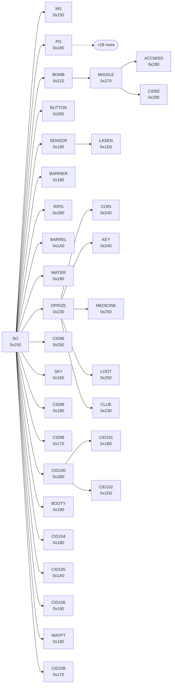
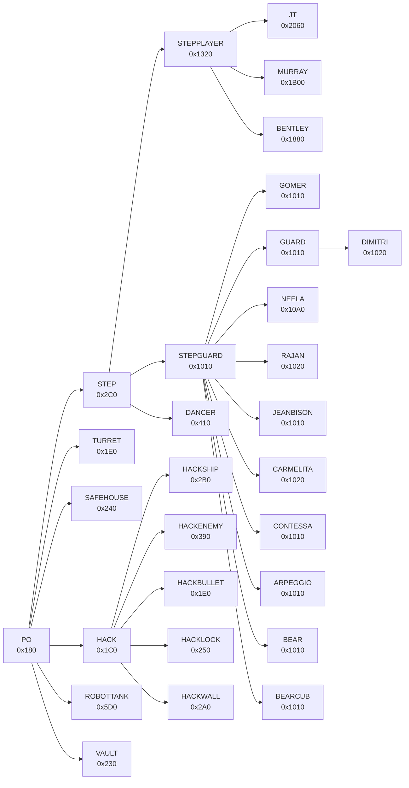
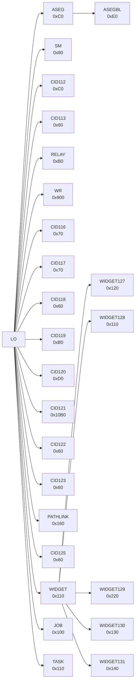
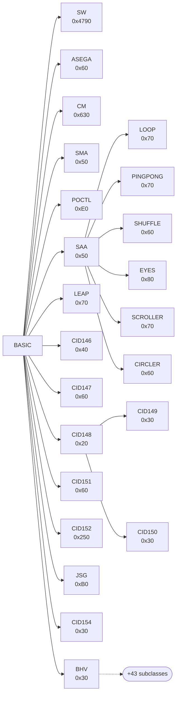

# Class reference

Doxygen-style reference for every class Sly 2 registers in its class-descriptor table, plus the C++ classes and polymorphic structs that live outside it. Structure (hierarchy, sizes, vtables, overrides) is read from the retail ELF `SCUS_973.16` and is exact `[C:static, ELF data]`; names come from the repo and carry the confidence shown on each page. Generated by `gen_classes.py` (re-run after renames). See also [object model](../../engine/object-model.md), [class tree](../class-tree.md) and [hidden types](../hidden-types.md).

## How the data was obtained

- **Descriptors.** `D_002BAAE8` holds 199 records of 0x14 bytes `{CLASSINFO *pclassinfoSuper; CID cid; CID cidMax; int cb; LO *(*pfnNew)();}`. CIDs are a pre-order numbering: `cidMax` is one past the last descendant. All 199 getters `Get<Cls>ClassDesc` (0x113A10 + 0x10*cid) were decoded and each loads its own record.
- **Vtables.** The ELF data sections were scanned for GCC 2.9x vtables: an all-zero entry 0 followed by 8-byte entries `{s16 delta; s16 index(0); pfn}` pointing into `.text`. 271 vtables were found; 215 of them are claimed by a registered class because slot 6 (`Pclassinfo`) points at that class's getter. Every delta is NOT zero, so there is no multiple-inheritance this-adjustment anywhere.
- **Slot numbering** is the entry index from the vtable start (entry 0 null), as in the object model page. Older tables (`cid_table.csv`, class-tree.md "Slots") count entries 1..N, so LO's "48 slots" = indices 1..48.
- **Overrides** compare each slot with the parent's vtable; inherited slots name the highest ancestor that owns the same function.
- **Fields** come from `include/sly2`; offsets are computed by clang with the EE data model and checked against the headers' own compile-time asserts (asserted fields are marked). Layout status: clang ok.
- **Header cross-check.** For the 27 registered classes with a struct in `include/sly2`, the number of virtual slots implied by the header's `virtual` declarations (GCC order: base slots, then new names) matches the ELF vtable length for 27.
- **Level instances** come from the whole-game census of all object records in the 43 world files.

## Subtrees

BASIC has 16 direct children: [SW](SW.md), [LO](LO.md), [ASEGA](ASEGA.md), [CM](CM.md), [SMA](SMA.md), [POCTL](POCTL.md), [SAA](SAA.md), [LEAP](LEAP.md), [CID146](CID146.md), [CID147](CID147.md), [CID148](CID148.md), [CID151](CID151.md), [CID152](CID152.md), [JSG](JSG.md), [CID154](CID154.md), [BHV](BHV.md).

### Top level (BASIC and LO, two levels deep)

```mermaid
graph LR
  c0["BASIC<br/>0x10"]
  c1["SW<br/>0x4790"]
  c0 --> c1
  c2["LO<br/>0x50"]
  c3["XFM<br/>0xE0"]
  c3 -.-> c3more(["+44 more"])
  c2 --> c3
  c48["SO<br/>0x150"]
  c48 -.-> c48more(["+60 more"])
  c2 --> c48
  c109["ASEG<br/>0xC0"]
  c109 -.-> c109more(["+1 more"])
  c2 --> c109
  c111["SM<br/>0x80"]
  c2 --> c111
  c112["CID112<br/>0xC0"]
  c2 --> c112
  c113["CID113<br/>0x60"]
  c2 --> c113
  c114["RELAY<br/>0xB0"]
  c2 --> c114
  c115["WR<br/>0x900"]
  c2 --> c115
  c116["CID116<br/>0x70"]
  c2 --> c116
  c117["CID117<br/>0x70"]
  c2 --> c117
  c118["CID118<br/>0x60"]
  c2 --> c118
  c119["CID119<br/>0xB0"]
  c2 --> c119
  c120["CID120<br/>0xD0"]
  c2 --> c120
  c121["CID121<br/>0x10B0"]
  c2 --> c121
  c122["CID122<br/>0x60"]
  c2 --> c122
  c123["CID123<br/>0x60"]
  c2 --> c123
  c124["PATHLINK<br/>0x160"]
  c2 --> c124
  c125["CID125<br/>0x60"]
  c2 --> c125
  c126["WIDGET<br/>0x110"]
  c126 -.-> c126more(["+5 more"])
  c2 --> c126
  c132["JOB<br/>0x100"]
  c2 --> c132
  c133["TASK<br/>0x110"]
  c2 --> c133
  c0 --> c2
  c134["ASEGA<br/>0x60"]
  c0 --> c134
  c135["CM<br/>0x630"]
  c0 --> c135
  c136["SMA<br/>0x50"]
  c0 --> c136
  c137["POCTL<br/>0xE0"]
  c0 --> c137
  c138["SAA<br/>0x50"]
  c139["LOOP<br/>0x70"]
  c138 --> c139
  c140["PINGPONG<br/>0x70"]
  c138 --> c140
  c141["SHUFFLE<br/>0x60"]
  c138 --> c141
  c142["EYES<br/>0x80"]
  c138 --> c142
  c143["SCROLLER<br/>0x70"]
  c138 --> c143
  c144["CIRCLER<br/>0x60"]
  c138 --> c144
  c0 --> c138
  c145["LEAP<br/>0x70"]
  c0 --> c145
  c146["CID146<br/>0x40"]
  c0 --> c146
  c147["CID147<br/>0x60"]
  c0 --> c147
  c148["CID148<br/>0x20"]
  c149["CID149<br/>0x30"]
  c148 --> c149
  c150["CID150<br/>0x30"]
  c148 --> c150
  c0 --> c148
  c151["CID151<br/>0x60"]
  c0 --> c151
  c152["CID152<br/>0x250"]
  c0 --> c152
  c153["JSG<br/>0xB0"]
  c0 --> c153
  c154["CID154<br/>0x30"]
  c0 --> c154
  c155["BHV<br/>0x30"]
  c156["BHVGUARD<br/>0xB0"]
  c155 --> c156
  c157["BHVANIM<br/>0x50"]
  c157 -.-> c157more(["+6 more"])
  c155 --> c157
  c164["BHVATTACK<br/>0x50"]
  c155 --> c164
  c165["BHVCOMBAT<br/>0x60"]
  c155 --> c165
  c166["BHVPATH<br/>0xC0"]
  c166 -.-> c166more(["+2 more"])
  c155 --> c166
  c169["BHV169<br/>0x60"]
  c155 --> c169
  c170["BHVPATROL<br/>0x50"]
  c155 --> c170
  c171["BHV171<br/>0xE0"]
  c155 --> c171
  c172["BHVLEAP<br/>0xA0"]
  c155 --> c172
  c173["BHV173<br/>0x40"]
  c155 --> c173
  c174["BHV174<br/>0x40"]
  c155 --> c174
  c175["BHV175<br/>0x60"]
  c155 --> c175
  c176["BHV176<br/>0x40"]
  c155 --> c176
  c177["BHVJUGGLED<br/>0x70"]
  c155 --> c177
  c178["BHV178<br/>0x50"]
  c155 --> c178
  c179["BHV179<br/>0x40"]
  c155 --> c179
  c180["BHV180<br/>0x40"]
  c155 --> c180
  c181["BHV181<br/>0x60"]
  c155 --> c181
  c182["BHV182<br/>0x50"]
  c155 --> c182
  c183["BHV183<br/>0x70"]
  c155 --> c183
  c184["BHVRAIL<br/>0x40"]
  c155 --> c184
  c185["BHVPIPE<br/>0x40"]
  c155 --> c185
  c186["BHVGOTO<br/>0xD0"]
  c155 --> c186
  c187["BHV187<br/>0x30"]
  c155 --> c187
  c188["BHV188<br/>0x30"]
  c155 --> c188
  c189["BHV189<br/>0x50"]
  c155 --> c189
  c190["BHVPATHLINK<br/>0x50"]
  c155 --> c190
  c191["BHV191<br/>0x50"]
  c155 --> c191
  c192["BHVPATROLPATH<br/>0x60"]
  c155 --> c192
  c193["BHV193<br/>0x50"]
  c155 --> c193
  c194["BHVFOLLOW<br/>0xA0"]
  c155 --> c194
  c195["BHV195<br/>0x40"]
  c155 --> c195
  c196["BHV196<br/>0x40"]
  c155 --> c196
  c197["BHV197<br/>0x40"]
  c155 --> c197
  c198["BHV198<br/>0x40"]
  c155 --> c198
  c0 --> c155
  click c0 "BASIC.md"
  click c1 "SW.md"
  click c2 "LO.md"
  click c3 "XFM.md"
  click c48 "SO.md"
  click c109 "ASEG.md"
  click c111 "SM.md"
  click c112 "CID112.md"
  click c113 "CID113.md"
  click c114 "RELAY.md"
  click c115 "WR.md"
  click c116 "CID116.md"
  click c117 "CID117.md"
  click c118 "CID118.md"
  click c119 "CID119.md"
  click c120 "CID120.md"
  click c121 "CID121.md"
  click c122 "CID122.md"
  click c123 "CID123.md"
  click c124 "PATHLINK.md"
  click c125 "CID125.md"
  click c126 "WIDGET.md"
  click c132 "JOB.md"
  click c133 "TASK.md"
  click c134 "ASEGA.md"
  click c135 "CM.md"
  click c136 "SMA.md"
  click c137 "POCTL.md"
  click c138 "SAA.md"
  click c139 "LOOP.md"
  click c140 "PINGPONG.md"
  click c141 "SHUFFLE.md"
  click c142 "EYES.md"
  click c143 "SCROLLER.md"
  click c144 "CIRCLER.md"
  click c145 "LEAP.md"
  click c146 "CID146.md"
  click c147 "CID147.md"
  click c148 "CID148.md"
  click c149 "CID149.md"
  click c150 "CID150.md"
  click c151 "CID151.md"
  click c152 "CID152.md"
  click c153 "JSG.md"
  click c154 "CID154.md"
  click c155 "BHV.md"
  click c156 "BHVGUARD.md"
  click c157 "BHVANIM.md"
  click c164 "BHVATTACK.md"
  click c165 "BHVCOMBAT.md"
  click c166 "BHVPATH.md"
  click c169 "BHV169.md"
  click c170 "BHVPATROL.md"
  click c171 "BHV171.md"
  click c172 "BHVLEAP.md"
  click c173 "BHV173.md"
  click c174 "BHV174.md"
  click c175 "BHV175.md"
  click c176 "BHV176.md"
  click c177 "BHVJUGGLED.md"
  click c178 "BHV178.md"
  click c179 "BHV179.md"
  click c180 "BHV180.md"
  click c181 "BHV181.md"
  click c182 "BHV182.md"
  click c183 "BHV183.md"
  click c184 "BHVRAIL.md"
  click c185 "BHVPIPE.md"
  click c186 "BHVGOTO.md"
  click c187 "BHV187.md"
  click c188 "BHV188.md"
  click c189 "BHV189.md"
  click c190 "BHVPATHLINK.md"
  click c191 "BHV191.md"
  click c192 "BHVPATROLPATH.md"
  click c193 "BHV193.md"
  click c194 "BHVFOLLOW.md"
  click c195 "BHV195.md"
  click c196 "BHV196.md"
  click c197 "BHV197.md"
  click c198 "BHV198.md"
```

### XFM: positioned lightweights (lights, proxies, shapes, volumes, emitters, ...)

```mermaid
graph LR
  c3["XFM<br/>0xE0"]
  c4["LIGHT<br/>0x170"]
  c3 --> c4
  c5["CID5<br/>0x120"]
  c3 --> c5
  c6["PROXY<br/>0x100"]
  c7["CLUEPROXY<br/>0x110"]
  c6 --> c7
  c3 --> c6
  c8["CID8<br/>0x100"]
  c9["CID9<br/>0x120"]
  c8 --> c9
  c3 --> c8
  c10["SHAPE<br/>0x190"]
  c11["PIPE<br/>0x1E0"]
  c10 --> c11
  c12["CID12<br/>0x1C0"]
  c10 --> c12
  c13["RAIL<br/>0x1D0"]
  c10 --> c13
  c14["CID14<br/>0x1F0"]
  c10 --> c14
  c3 --> c10
  c15["TN<br/>0x1C0"]
  c3 --> c15
  c16["DETECTOR<br/>0x180"]
  c3 --> c16
  c17["PATHZONE<br/>0x130"]
  c3 --> c17
  c18["TARGET<br/>0x100"]
  c19["HND<br/>0x140"]
  c18 --> c19
  c3 --> c18
  c20["CID20<br/>0xF0"]
  c3 --> c20
  c21["CID21<br/>0x100"]
  c3 --> c21
  c22["VOL<br/>0x130"]
  c23["CID23<br/>0x140"]
  c22 --> c23
  c24["VOLBTN<br/>0x2D0"]
  c25["CID25<br/>0x2D0"]
  c24 --> c25
  c22 --> c24
  c26["EXIT<br/>0x190"]
  c22 --> c26
  c27["CID27<br/>0x160"]
  c22 --> c27
  c3 --> c22
  c28["BLIPG<br/>0x460"]
  c3 --> c28
  c29["EMITTER<br/>0x160"]
  c3 --> c29
  c30["EXPL<br/>0xE0"]
  c31["EXPLG<br/>0xF0"]
  c30 --> c31
  c32["EXPLO<br/>0xF0"]
  c33["EXPLS<br/>0x110"]
  c32 --> c33
  c30 --> c32
  c3 --> c30
  c34["CID34<br/>0x110"]
  c3 --> c34
  c35["CID35<br/>0x180"]
  c36["CID36<br/>0x1A0"]
  c35 --> c36
  c37["CID37<br/>0x1A0"]
  c35 --> c37
  c3 --> c35
  c38["CID38<br/>0x110"]
  c3 --> c38
  c39["CID39<br/>0x110"]
  c3 --> c39
  c40["CID40<br/>0xF0"]
  c3 --> c40
  c41["CID41<br/>0xE0"]
  c3 --> c41
  c42["WARP<br/>0x180"]
  c3 --> c42
  c43["CID43<br/>0x100"]
  c3 --> c43
  c44["CID44<br/>0x140"]
  c3 --> c44
  c45["CID45<br/>0x130"]
  c3 --> c45
  c46["CID46<br/>0x120"]
  c3 --> c46
  c47["CID47<br/>0x110"]
  c3 --> c47
  click c3 "XFM.md"
  click c4 "LIGHT.md"
  click c5 "CID5.md"
  click c6 "PROXY.md"
  click c7 "CLUEPROXY.md"
  click c8 "CID8.md"
  click c9 "CID9.md"
  click c10 "SHAPE.md"
  click c11 "PIPE.md"
  click c12 "CID12.md"
  click c13 "RAIL.md"
  click c14 "CID14.md"
  click c15 "TN.md"
  click c16 "DETECTOR.md"
  click c17 "PATHZONE.md"
  click c18 "TARGET.md"
  click c19 "HND.md"
  click c20 "CID20.md"
  click c21 "CID21.md"
  click c22 "VOL.md"
  click c23 "CID23.md"
  click c24 "VOLBTN.md"
  click c25 "CID25.md"
  click c26 "EXIT.md"
  click c27 "CID27.md"
  click c28 "BLIPG.md"
  click c29 "EMITTER.md"
  click c30 "EXPL.md"
  click c31 "EXPLG.md"
  click c32 "EXPLO.md"
  click c33 "EXPLS.md"
  click c34 "CID34.md"
  click c35 "CID35.md"
  click c36 "CID36.md"
  click c37 "CID37.md"
  click c38 "CID38.md"
  click c39 "CID39.md"
  click c40 "CID40.md"
  click c41 "CID41.md"
  click c42 "WARP.md"
  click c43 "CID43.md"
  click c44 "CID44.md"
  click c45 "CID45.md"
  click c46 "CID46.md"
  click c47 "CID47.md"
```

### SO: physical objects (SO, PO, gadgets, pickups, ...); PO subtree collapsed

### PO: controllable objects → STEP → STEPPLAYER / STEPGUARD

### LO children that are not XFM or SO (animation, state machines, scripted sequences, widgets/HUD, jobs)

### BASIC children that are not LO (world, camera, animation/shader helpers, sound, behaviours)

### BHV: guard and player behaviours

```mermaid
graph LR
  c155["BHV<br/>0x30"]
  c156["BHVGUARD<br/>0xB0"]
  c155 --> c156
  c157["BHVANIM<br/>0x50"]
  c158["BHVIDLE<br/>0x50"]
  c157 --> c158
  c159["BHVSTRIKE<br/>0x60"]
  c157 --> c159
  c160["BHVHIT<br/>0xC0"]
  c161["BHV161<br/>0xC0"]
  c160 --> c161
  c162["BHV162<br/>0xC0"]
  c160 --> c162
  c163["BHVKO<br/>0xC0"]
  c160 --> c163
  c157 --> c160
  c155 --> c157
  c164["BHVATTACK<br/>0x50"]
  c155 --> c164
  c165["BHVCOMBAT<br/>0x60"]
  c155 --> c165
  c166["BHVPATH<br/>0xC0"]
  c167["BHVWALKPATH<br/>0xF0"]
  c166 --> c167
  c168["BHVWALKGOAL<br/>0xE0"]
  c166 --> c168
  c155 --> c166
  c169["BHV169<br/>0x60"]
  c155 --> c169
  c170["BHVPATROL<br/>0x50"]
  c155 --> c170
  c171["BHV171<br/>0xE0"]
  c155 --> c171
  c172["BHVLEAP<br/>0xA0"]
  c155 --> c172
  c173["BHV173<br/>0x40"]
  c155 --> c173
  c174["BHV174<br/>0x40"]
  c155 --> c174
  c175["BHV175<br/>0x60"]
  c155 --> c175
  c176["BHV176<br/>0x40"]
  c155 --> c176
  c177["BHVJUGGLED<br/>0x70"]
  c155 --> c177
  c178["BHV178<br/>0x50"]
  c155 --> c178
  c179["BHV179<br/>0x40"]
  c155 --> c179
  c180["BHV180<br/>0x40"]
  c155 --> c180
  c181["BHV181<br/>0x60"]
  c155 --> c181
  c182["BHV182<br/>0x50"]
  c155 --> c182
  c183["BHV183<br/>0x70"]
  c155 --> c183
  c184["BHVRAIL<br/>0x40"]
  c155 --> c184
  c185["BHVPIPE<br/>0x40"]
  c155 --> c185
  c186["BHVGOTO<br/>0xD0"]
  c155 --> c186
  c187["BHV187<br/>0x30"]
  c155 --> c187
  c188["BHV188<br/>0x30"]
  c155 --> c188
  c189["BHV189<br/>0x50"]
  c155 --> c189
  c190["BHVPATHLINK<br/>0x50"]
  c155 --> c190
  c191["BHV191<br/>0x50"]
  c155 --> c191
  c192["BHVPATROLPATH<br/>0x60"]
  c155 --> c192
  c193["BHV193<br/>0x50"]
  c155 --> c193
  c194["BHVFOLLOW<br/>0xA0"]
  c155 --> c194
  c195["BHV195<br/>0x40"]
  c155 --> c195
  c196["BHV196<br/>0x40"]
  c155 --> c196
  c197["BHV197<br/>0x40"]
  c155 --> c197
  c198["BHV198<br/>0x40"]
  c155 --> c198
  click c155 "BHV.md"
  click c156 "BHVGUARD.md"
  click c157 "BHVANIM.md"
  click c158 "BHVIDLE.md"
  click c159 "BHVSTRIKE.md"
  click c160 "BHVHIT.md"
  click c161 "BHV161.md"
  click c162 "BHV162.md"
  click c163 "BHVKO.md"
  click c164 "BHVATTACK.md"
  click c165 "BHVCOMBAT.md"
  click c166 "BHVPATH.md"
  click c167 "BHVWALKPATH.md"
  click c168 "BHVWALKGOAL.md"
  click c169 "BHV169.md"
  click c170 "BHVPATROL.md"
  click c171 "BHV171.md"
  click c172 "BHVLEAP.md"
  click c173 "BHV173.md"
  click c174 "BHV174.md"
  click c175 "BHV175.md"
  click c176 "BHV176.md"
  click c177 "BHVJUGGLED.md"
  click c178 "BHV178.md"
  click c179 "BHV179.md"
  click c180 "BHV180.md"
  click c181 "BHV181.md"
  click c182 "BHV182.md"
  click c183 "BHV183.md"
  click c184 "BHVRAIL.md"
  click c185 "BHVPIPE.md"
  click c186 "BHVGOTO.md"
  click c187 "BHV187.md"
  click c188 "BHV188.md"
  click c189 "BHV189.md"
  click c190 "BHVPATHLINK.md"
  click c191 "BHV191.md"
  click c192 "BHVPATROLPATH.md"
  click c193 "BHV193.md"
  click c194 "BHVFOLLOW.md"
  click c195 "BHV195.md"
  click c196 "BHV196.md"
  click c197 "BHV197.md"
  click c198 "BHV198.md"
```

## All registered classes

Name confidence: **high** = Sucker Punch name (Sly 1 / Lilly symbol); **medium/low** = team coinage; **placeholder** = `CIDnn`/`BHVnnn` (decimal CID). New / Ovr = vtable slots added / overridden relative to the parent.

| CID | Class | Parent | Size | vtable | Slots | New | Ovr | Levels (objects) | Name confidence |
|---|---|---|---|---|---|---|---|---|---|
| 0 (0x00) | [BASIC](BASIC.md) |  | 0x10 | `0x2CB1F0` `0x2D36D0` `0x2D3750` `0x2D37D0` `0x2D8368` `0x2D83E8` `0x2D8468` `0x2D84E8` `0x2D8568` `0x2D85E8` `0x2D8668` `0x2D86D0` `0x2D8C08` | 6 |  |  |  | high |
| 1 (0x01) | &nbsp;&nbsp;[SW](SW.md) | [BASIC](BASIC.md) | 0x4790 | `0x2DC018` | 9 | 3 | 1 |  | high |
| 2 (0x02) | &nbsp;&nbsp;[LO](LO.md) | [BASIC](BASIC.md) | 0x50 | `0x2D3540` | 48 | 42 | 2 | 42 (178) | high |
| 3 (0x03) | &nbsp;&nbsp;&nbsp;&nbsp;[XFM](XFM.md) | [LO](LO.md) | 0xE0 | `0x2DD090` | 50 | 2 | 12 | 42 (4619) | high |
| 4 (0x04) | &nbsp;&nbsp;&nbsp;&nbsp;&nbsp;&nbsp;[LIGHT](LIGHT.md) | [XFM](XFM.md) | 0x170 | `0x2D33A0` | 50 | 0 | 10 | 42 (2855) | high |
| 5 (0x05) | &nbsp;&nbsp;&nbsp;&nbsp;&nbsp;&nbsp;[CID5](CID5.md) | [XFM](XFM.md) | 0x120 | `0x2DC070` | 50 | 0 | 3 | 12 (30) | placeholder (decimal CID) |
| 6 (0x06) | &nbsp;&nbsp;&nbsp;&nbsp;&nbsp;&nbsp;[PROXY](PROXY.md) | [XFM](XFM.md) | 0x100 | `0x2D6E08` | 50 | 0 | 5 | 43 (19259) | high |
| 7 (0x07) | &nbsp;&nbsp;&nbsp;&nbsp;&nbsp;&nbsp;&nbsp;&nbsp;[CLUEPROXY](CLUEPROXY.md) | [PROXY](PROXY.md) | 0x110 | `0x2D5DC8` | 50 | 0 | 2 | 8 (240) | medium |
| 8 (0x08) | &nbsp;&nbsp;&nbsp;&nbsp;&nbsp;&nbsp;[CID8](CID8.md) | [XFM](XFM.md) | 0x100 | `0x2D2CB8` | 50 | 0 | 3 |  | placeholder (decimal CID) |
| 9 (0x09) | &nbsp;&nbsp;&nbsp;&nbsp;&nbsp;&nbsp;&nbsp;&nbsp;[CID9](CID9.md) | [CID8](CID8.md) | 0x120 | `0x2D2B18` | 50 | 0 | 6 | 2 (9) | placeholder (decimal CID) |
| 10 (0x0A) | &nbsp;&nbsp;&nbsp;&nbsp;&nbsp;&nbsp;[SHAPE](SHAPE.md) | [XFM](XFM.md) | 0x190 | `0x2D9040` | 50 | 0 | 5 | 42 (3140) | high |
| 11 (0x0B) | &nbsp;&nbsp;&nbsp;&nbsp;&nbsp;&nbsp;&nbsp;&nbsp;[PIPE](PIPE.md) | [SHAPE](SHAPE.md) | 0x1E0 | `0x2D56F8` | 50 | 0 | 6 | 26 (246) | medium |
| 12 (0x0C) | &nbsp;&nbsp;&nbsp;&nbsp;&nbsp;&nbsp;&nbsp;&nbsp;[CID12](CID12.md) | [SHAPE](SHAPE.md) | 0x1C0 | `0x2D2738` | 50 | 0 | 6 | 15 (43) | placeholder (decimal CID) |
| 13 (0x0D) | &nbsp;&nbsp;&nbsp;&nbsp;&nbsp;&nbsp;&nbsp;&nbsp;[RAIL](RAIL.md) | [SHAPE](SHAPE.md) | 0x1D0 | `0x2D6FE8` | 50 | 0 | 6 | 23 (356) | medium |
| 14 (0x0E) | &nbsp;&nbsp;&nbsp;&nbsp;&nbsp;&nbsp;&nbsp;&nbsp;[CID14](CID14.md) | [SHAPE](SHAPE.md) | 0x1F0 | `0x2D4DE0` | 50 | 0 | 7 | 36 (179) | placeholder (decimal CID) |
| 15 (0x0F) | &nbsp;&nbsp;&nbsp;&nbsp;&nbsp;&nbsp;[TN](TN.md) | [XFM](XFM.md) | 0x1C0 | `0x2DB6B8` | 50 | 0 | 8 | 42 (619) | high |
| 16 (0x10) | &nbsp;&nbsp;&nbsp;&nbsp;&nbsp;&nbsp;[DETECTOR](DETECTOR.md) | [XFM](XFM.md) | 0x180 | `0x2CDBA0` | 50 | 0 | 3 | 13 (22) | medium |
| 17 (0x11) | &nbsp;&nbsp;&nbsp;&nbsp;&nbsp;&nbsp;[PATHZONE](PATHZONE.md) | [XFM](XFM.md) | 0x130 | `0x2D52B0` | 50 | 0 | 3 | 40 (986) | medium |
| 18 (0x12) | &nbsp;&nbsp;&nbsp;&nbsp;&nbsp;&nbsp;[TARGET](TARGET.md) | [XFM](XFM.md) | 0x100 | `0x2DB518` | 50 | 0 | 6 | 38 (102) | high |
| 19 (0x13) | &nbsp;&nbsp;&nbsp;&nbsp;&nbsp;&nbsp;&nbsp;&nbsp;[HND](HND.md) | [TARGET](TARGET.md) | 0x140 | `0x2D2978` | 50 | 0 | 2 | 12 (74) | medium-high |
| 20 (0x14) | &nbsp;&nbsp;&nbsp;&nbsp;&nbsp;&nbsp;[CID20](CID20.md) | [XFM](XFM.md) | 0xF0 | `0x2C9A80` | 50 | 0 | 1 | 42 (84) | placeholder (decimal CID) |
| 21 (0x15) | &nbsp;&nbsp;&nbsp;&nbsp;&nbsp;&nbsp;[CID21](CID21.md) | [XFM](XFM.md) | 0x100 | `0x2DB378` | 50 | 0 | 5 | 2 (5) | placeholder (decimal CID) |
| 22 (0x16) | &nbsp;&nbsp;&nbsp;&nbsp;&nbsp;&nbsp;[VOL](VOL.md) | [XFM](XFM.md) | 0x130 | `0x2DC3B0` | 50 | 0 | 2 | 40 (399) | high |
| 23 (0x17) | &nbsp;&nbsp;&nbsp;&nbsp;&nbsp;&nbsp;&nbsp;&nbsp;[CID23](CID23.md) | [VOL](VOL.md) | 0x140 | `0x2DC210` | 50 | 0 | 3 | 42 (42) | placeholder (decimal CID) |
| 24 (0x18) | &nbsp;&nbsp;&nbsp;&nbsp;&nbsp;&nbsp;&nbsp;&nbsp;[VOLBTN](VOLBTN.md) | [VOL](VOL.md) | 0x2D0 | `0x2CC7B0` | 50 | 0 | 7 | 39 (482) | high |
| 25 (0x19) | &nbsp;&nbsp;&nbsp;&nbsp;&nbsp;&nbsp;&nbsp;&nbsp;&nbsp;&nbsp;[CID25](CID25.md) | [VOLBTN](VOLBTN.md) | 0x2D0 | `0x2C9C20` | 50 | 0 | 1 | 3 (3) | placeholder (decimal CID) |
| 26 (0x1A) | &nbsp;&nbsp;&nbsp;&nbsp;&nbsp;&nbsp;&nbsp;&nbsp;[EXIT](EXIT.md) | [VOL](VOL.md) | 0x190 | `0x2DC6F0` | 50 | 0 | 4 | 43 (370) | medium |
| 27 (0x1B) | &nbsp;&nbsp;&nbsp;&nbsp;&nbsp;&nbsp;&nbsp;&nbsp;[CID27](CID27.md) | [VOL](VOL.md) | 0x160 | `0x2D1B60` | 50 | 0 | 5 | 28 (159) | placeholder (decimal CID) |
| 28 (0x1C) | &nbsp;&nbsp;&nbsp;&nbsp;&nbsp;&nbsp;[BLIPG](BLIPG.md) | [XFM](XFM.md) | 0x460 | `0x2CB5D8` | 51 | 1 | 7 |  | high |
| 29 (0x1D) | &nbsp;&nbsp;&nbsp;&nbsp;&nbsp;&nbsp;[EMITTER](EMITTER.md) | [XFM](XFM.md) | 0x160 | `0x2CEB78` `0x2CED18` | 50 |  | 7 | 42 (6230) | high |
| 30 (0x1E) | &nbsp;&nbsp;&nbsp;&nbsp;&nbsp;&nbsp;[EXPL](EXPL.md) | [XFM](XFM.md) | 0xE0 | `0x2CE9D0` | 51 | 1 | 1 |  | high |
| 31 (0x1F) | &nbsp;&nbsp;&nbsp;&nbsp;&nbsp;&nbsp;&nbsp;&nbsp;[EXPLG](EXPLG.md) | [EXPL](EXPL.md) | 0xF0 | `0x2CE828` | 51 | 0 | 5 | 42 (1958) | high |
| 32 (0x20) | &nbsp;&nbsp;&nbsp;&nbsp;&nbsp;&nbsp;&nbsp;&nbsp;[EXPLO](EXPLO.md) | [EXPL](EXPL.md) | 0xF0 | `0x2CA098` `0x2CE680` | 51 |  | 4 | 42 (52) | high |
| 33 (0x21) | &nbsp;&nbsp;&nbsp;&nbsp;&nbsp;&nbsp;&nbsp;&nbsp;&nbsp;&nbsp;[EXPLS](EXPLS.md) | [EXPLO](EXPLO.md) | 0x110 | `0x2CE4D0` | 52 | 1 | 3 | 42 (8381) | high |
| 34 (0x22) | &nbsp;&nbsp;&nbsp;&nbsp;&nbsp;&nbsp;[CID34](CID34.md) | [XFM](XFM.md) | 0x110 | `0x2D2558` | 50 | 0 | 6 |  | placeholder (decimal CID) |
| 35 (0x23) | &nbsp;&nbsp;&nbsp;&nbsp;&nbsp;&nbsp;[CID35](CID35.md) | [XFM](XFM.md) | 0x180 | `0x2D1EE8` | 51 | 1 | 5 | 34 (157) | placeholder (decimal CID) |
| 36 (0x24) | &nbsp;&nbsp;&nbsp;&nbsp;&nbsp;&nbsp;&nbsp;&nbsp;[CID36](CID36.md) | [CID35](CID35.md) | 0x1A0 | `0x2D1D00` | 51 | 0 | 4 | 40 (204) | placeholder (decimal CID) |
| 37 (0x25) | &nbsp;&nbsp;&nbsp;&nbsp;&nbsp;&nbsp;&nbsp;&nbsp;[CID37](CID37.md) | [CID35](CID35.md) | 0x1A0 | `0x2CB9F8` | 51 | 0 | 5 | 12 (15) | placeholder (decimal CID) |
| 38 (0x26) | &nbsp;&nbsp;&nbsp;&nbsp;&nbsp;&nbsp;[CID38](CID38.md) | [XFM](XFM.md) | 0x110 | `0x2D2378` | 50 | 0 | 6 | 1 (12) | placeholder (decimal CID) |
| 39 (0x27) | &nbsp;&nbsp;&nbsp;&nbsp;&nbsp;&nbsp;[CID39](CID39.md) | [XFM](XFM.md) | 0x110 | `0x2D9DD0` | 50 | 0 | 6 | 22 (175) | placeholder (decimal CID) |
| 40 (0x28) | &nbsp;&nbsp;&nbsp;&nbsp;&nbsp;&nbsp;[CID40](CID40.md) | [XFM](XFM.md) | 0xF0 | `0x2D3200` | 50 | 0 | 5 | 1 (1) | placeholder (decimal CID) |
| 41 (0x29) | &nbsp;&nbsp;&nbsp;&nbsp;&nbsp;&nbsp;[CID41](CID41.md) | [XFM](XFM.md) | 0xE0 | `0x2DC890` | 50 | 0 | 2 | 38 (228) | placeholder (decimal CID) |
| 42 (0x2A) | &nbsp;&nbsp;&nbsp;&nbsp;&nbsp;&nbsp;[WARP](WARP.md) | [XFM](XFM.md) | 0x180 | `0x2DC550` | 50 | 0 | 2 | 42 (282) | medium |
| 43 (0x2B) | &nbsp;&nbsp;&nbsp;&nbsp;&nbsp;&nbsp;[CID43](CID43.md) | [XFM](XFM.md) | 0x100 | `0x2CABD8` | 50 | 0 | 6 | 42 (1092) | placeholder (decimal CID) |
| 44 (0x2C) | &nbsp;&nbsp;&nbsp;&nbsp;&nbsp;&nbsp;[CID44](CID44.md) | [XFM](XFM.md) | 0x140 | `0x2CA9F0` | 50 | 0 | 8 | 42 (182) | placeholder (decimal CID) |
| 45 (0x2D) | &nbsp;&nbsp;&nbsp;&nbsp;&nbsp;&nbsp;[CID45](CID45.md) | [XFM](XFM.md) | 0x130 | `0x2D4F80` | 50 | 0 | 4 | 42 (252) | placeholder (decimal CID) |
| 46 (0x2E) | &nbsp;&nbsp;&nbsp;&nbsp;&nbsp;&nbsp;[CID46](CID46.md) | [XFM](XFM.md) | 0x120 | `0x2D9F70` | 50 | 0 | 5 | 10 (54) | placeholder (decimal CID) |
| 47 (0x2F) | &nbsp;&nbsp;&nbsp;&nbsp;&nbsp;&nbsp;[CID47](CID47.md) | [XFM](XFM.md) | 0x110 | `0x2CE118` | 50 | 0 | 6 | 4 (4) | placeholder (decimal CID) |
| 48 (0x30) | &nbsp;&nbsp;&nbsp;&nbsp;[SO](SO.md) | [LO](LO.md) | 0x150 | `0x2D9978` | 75 | 27 | 36 | 43 (8723) | high |
| 49 (0x31) | &nbsp;&nbsp;&nbsp;&nbsp;&nbsp;&nbsp;[MS](MS.md) | [SO](SO.md) | 0x150 | `0x2D4260` | 75 | 0 | 3 | 42 (118) | high |
| 50 (0x32) | &nbsp;&nbsp;&nbsp;&nbsp;&nbsp;&nbsp;[PO](PO.md) | [SO](SO.md) | 0x180 | `0x2D5898` | 81 | 6 | 5 | 12 (12) | high |
| 51 (0x33) | &nbsp;&nbsp;&nbsp;&nbsp;&nbsp;&nbsp;&nbsp;&nbsp;[STEP](STEP.md) | [PO](PO.md) | 0x2C0 | `0x2DA110` | 87 | 6 | 17 |  | high |
| 52 (0x34) | &nbsp;&nbsp;&nbsp;&nbsp;&nbsp;&nbsp;&nbsp;&nbsp;&nbsp;&nbsp;[STEPPLAYER](STEPPLAYER.md) | [STEP](STEP.md) | 0x1320 | `0x2CBE68` | 105 | 18 | 26 |  | high |
| 53 (0x35) | &nbsp;&nbsp;&nbsp;&nbsp;&nbsp;&nbsp;&nbsp;&nbsp;&nbsp;&nbsp;&nbsp;&nbsp;[JT](JT.md) | [STEPPLAYER](STEPPLAYER.md) | 0x2060 | `0x2D2E98` | 107 | 2 | 31 | 42 (42) | high |
| 54 (0x36) | &nbsp;&nbsp;&nbsp;&nbsp;&nbsp;&nbsp;&nbsp;&nbsp;&nbsp;&nbsp;&nbsp;&nbsp;[MURRAY](MURRAY.md) | [STEPPLAYER](STEPPLAYER.md) | 0x1B00 | `0x2D44C8` | 105 | 0 | 24 | 42 (42) | high |
| 55 (0x37) | &nbsp;&nbsp;&nbsp;&nbsp;&nbsp;&nbsp;&nbsp;&nbsp;&nbsp;&nbsp;&nbsp;&nbsp;[BENTLEY](BENTLEY.md) | [STEPPLAYER](STEPPLAYER.md) | 0x1880 | `0x2CB230` | 105 | 0 | 22 | 42 (42) | high |
| 56 (0x38) | &nbsp;&nbsp;&nbsp;&nbsp;&nbsp;&nbsp;&nbsp;&nbsp;&nbsp;&nbsp;[STEPGUARD](STEPGUARD.md) | [STEP](STEP.md) | 0x1010 | `0x2DA568` | 89 | 2 | 20 |  | high |
| 57 (0x39) | &nbsp;&nbsp;&nbsp;&nbsp;&nbsp;&nbsp;&nbsp;&nbsp;&nbsp;&nbsp;&nbsp;&nbsp;[GOMER](GOMER.md) | [STEPGUARD](STEPGUARD.md) | 0x1010 | `0x2CF520` | 89 | 0 | 2 | 34 (66) | high |
| 58 (0x3A) | &nbsp;&nbsp;&nbsp;&nbsp;&nbsp;&nbsp;&nbsp;&nbsp;&nbsp;&nbsp;&nbsp;&nbsp;[GUARD](GUARD.md) | [STEPGUARD](STEPGUARD.md) | 0x1010 | `0x2C9DC0` | 89 | 0 | 1 | 28 (28) | medium |
| 59 (0x3B) | &nbsp;&nbsp;&nbsp;&nbsp;&nbsp;&nbsp;&nbsp;&nbsp;&nbsp;&nbsp;&nbsp;&nbsp;&nbsp;&nbsp;[DIMITRI](DIMITRI.md) | [GUARD](GUARD.md) | 0x1020 | `0x2CDE40` | 89 | 0 | 3 | 2 (2) | medium |
| 60 (0x3C) | &nbsp;&nbsp;&nbsp;&nbsp;&nbsp;&nbsp;&nbsp;&nbsp;&nbsp;&nbsp;&nbsp;&nbsp;[NEELA](NEELA.md) | [STEPGUARD](STEPGUARD.md) | 0x10A0 | `0x2D4820` | 89 | 0 | 5 | 9 (9) | medium |
| 61 (0x3D) | &nbsp;&nbsp;&nbsp;&nbsp;&nbsp;&nbsp;&nbsp;&nbsp;&nbsp;&nbsp;&nbsp;&nbsp;[RAJAN](RAJAN.md) | [STEPGUARD](STEPGUARD.md) | 0x1020 | `0x2D7188` | 90 | 1 | 3 | 3 (3) | medium |
| 62 (0x3E) | &nbsp;&nbsp;&nbsp;&nbsp;&nbsp;&nbsp;&nbsp;&nbsp;&nbsp;&nbsp;&nbsp;&nbsp;[JEANBISON](JEANBISON.md) | [STEPGUARD](STEPGUARD.md) | 0x1010 | `0x2C91C8` | 89 | 0 | 1 | 6 (6) | medium |
| 63 (0x3F) | &nbsp;&nbsp;&nbsp;&nbsp;&nbsp;&nbsp;&nbsp;&nbsp;&nbsp;&nbsp;&nbsp;&nbsp;[CARMELITA](CARMELITA.md) | [STEPGUARD](STEPGUARD.md) | 0x1020 | `0x2CCBB8` | 89 | 0 | 6 | 7 (7) | medium |
| 64 (0x40) | &nbsp;&nbsp;&nbsp;&nbsp;&nbsp;&nbsp;&nbsp;&nbsp;&nbsp;&nbsp;&nbsp;&nbsp;[CONTESSA](CONTESSA.md) | [STEPGUARD](STEPGUARD.md) | 0x1010 | `0x2CD0A0` | 89 | 0 | 3 | 6 (6) | medium |
| 65 (0x41) | &nbsp;&nbsp;&nbsp;&nbsp;&nbsp;&nbsp;&nbsp;&nbsp;&nbsp;&nbsp;&nbsp;&nbsp;[ARPEGGIO](ARPEGGIO.md) | [STEPGUARD](STEPGUARD.md) | 0x1010 | `0x2C8EF0` | 89 | 0 | 1 | 2 (2) | medium |
| 66 (0x42) | &nbsp;&nbsp;&nbsp;&nbsp;&nbsp;&nbsp;&nbsp;&nbsp;&nbsp;&nbsp;&nbsp;&nbsp;[BEAR](BEAR.md) | [STEPGUARD](STEPGUARD.md) | 0x1010 | `0x2C8C18` | 89 | 0 | 1 | 3 (3) | medium |
| 67 (0x43) | &nbsp;&nbsp;&nbsp;&nbsp;&nbsp;&nbsp;&nbsp;&nbsp;&nbsp;&nbsp;&nbsp;&nbsp;[BEARCUB](BEARCUB.md) | [STEPGUARD](STEPGUARD.md) | 0x1010 | `0x2C8940` | 89 | 0 | 1 | 1 (1) | medium |
| 68 (0x44) | &nbsp;&nbsp;&nbsp;&nbsp;&nbsp;&nbsp;&nbsp;&nbsp;&nbsp;&nbsp;[DANCER](DANCER.md) | [STEP](STEP.md) | 0x410 | `0x2CD748` | 87 | 0 | 6 | 1 (1) | medium |
| 69 (0x45) | &nbsp;&nbsp;&nbsp;&nbsp;&nbsp;&nbsp;&nbsp;&nbsp;[TURRET](TURRET.md) | [PO](PO.md) | 0x1E0 | `0x2DBD80` | 81 | 0 | 7 | 6 (6) | medium |
| 70 (0x46) | &nbsp;&nbsp;&nbsp;&nbsp;&nbsp;&nbsp;&nbsp;&nbsp;[SAFEHOUSE](SAFEHOUSE.md) | [PO](PO.md) | 0x240 | `0x2D80D0` | 81 | 0 | 5 | 8 (8) | medium |
| 71 (0x47) | &nbsp;&nbsp;&nbsp;&nbsp;&nbsp;&nbsp;&nbsp;&nbsp;[HACK](HACK.md) | [PO](PO.md) | 0x1C0 | `0x2D1878` | 83 | 2 | 7 |  | medium |
| 72 (0x48) | &nbsp;&nbsp;&nbsp;&nbsp;&nbsp;&nbsp;&nbsp;&nbsp;&nbsp;&nbsp;[HACKSHIP](HACKSHIP.md) | [HACK](HACK.md) | 0x2B0 | `0x2D15D0` | 83 | 0 | 9 | 5 (5) | medium |
| 73 (0x49) | &nbsp;&nbsp;&nbsp;&nbsp;&nbsp;&nbsp;&nbsp;&nbsp;&nbsp;&nbsp;[HACKENEMY](HACKENEMY.md) | [HACK](HACK.md) | 0x390 | `0x2D1080` | 83 | 0 | 11 | 5 (26) | medium |
| 74 (0x4A) | &nbsp;&nbsp;&nbsp;&nbsp;&nbsp;&nbsp;&nbsp;&nbsp;&nbsp;&nbsp;[HACKBULLET](HACKBULLET.md) | [HACK](HACK.md) | 0x1E0 | `0x2D1328` | 83 | 0 | 5 | 5 (7) | medium |
| 75 (0x4B) | &nbsp;&nbsp;&nbsp;&nbsp;&nbsp;&nbsp;&nbsp;&nbsp;&nbsp;&nbsp;[HACKLOCK](HACKLOCK.md) | [HACK](HACK.md) | 0x250 | `0x2D0DD8` | 83 | 0 | 5 | 5 (5) | medium |
| 76 (0x4C) | &nbsp;&nbsp;&nbsp;&nbsp;&nbsp;&nbsp;&nbsp;&nbsp;&nbsp;&nbsp;[HACKWALL](HACKWALL.md) | [HACK](HACK.md) | 0x2A0 | `0x2D0B30` | 83 | 0 | 12 | 5 (22) | medium |
| 77 (0x4D) | &nbsp;&nbsp;&nbsp;&nbsp;&nbsp;&nbsp;&nbsp;&nbsp;[ROBOTTANK](ROBOTTANK.md) | [PO](PO.md) | 0x5D0 | `0x2D7CA8` | 81 | 0 | 14 | 1 (1) | medium |
| 78 (0x4E) | &nbsp;&nbsp;&nbsp;&nbsp;&nbsp;&nbsp;&nbsp;&nbsp;[VAULT](VAULT.md) | [PO](PO.md) | 0x230 | `0x2D5B30` | 81 | 0 | 4 | 8 (8) | medium |
| 79 (0x4F) | &nbsp;&nbsp;&nbsp;&nbsp;&nbsp;&nbsp;[BOMB](BOMB.md) | [SO](SO.md) | 0x210 | `0x2CB780` | 77 | 2 | 10 | 34 (100) | high |
| 80 (0x50) | &nbsp;&nbsp;&nbsp;&nbsp;&nbsp;&nbsp;&nbsp;&nbsp;[MISSILE](MISSILE.md) | [BOMB](BOMB.md) | 0x270 | `0x2D3FA0` | 78 | 1 | 6 |  | high |
| 81 (0x51) | &nbsp;&nbsp;&nbsp;&nbsp;&nbsp;&nbsp;&nbsp;&nbsp;&nbsp;&nbsp;[ACCMISS](ACCMISS.md) | [MISSILE](MISSILE.md) | 0x280 | `0x2D3D20` | 78 | 0 | 3 | 42 (132) | high |
| 82 (0x52) | &nbsp;&nbsp;&nbsp;&nbsp;&nbsp;&nbsp;&nbsp;&nbsp;&nbsp;&nbsp;[CID82](CID82.md) | [MISSILE](MISSILE.md) | 0x290 | `0x2D3AA0` | 78 | 0 | 4 | 14 (20) | placeholder (decimal CID) |
| 83 (0x53) | &nbsp;&nbsp;&nbsp;&nbsp;&nbsp;&nbsp;[BUTTON](BUTTON.md) | [SO](SO.md) | 0x300 | `0x2CC950` | 75 | 0 | 8 | 30 (92) | medium |
| 84 (0x54) | &nbsp;&nbsp;&nbsp;&nbsp;&nbsp;&nbsp;[SENSOR](SENSOR.md) | [SO](SO.md) | 0x190 | `0x2D89A0` | 75 | 0 | 3 |  | medium |
| 85 (0x55) | &nbsp;&nbsp;&nbsp;&nbsp;&nbsp;&nbsp;&nbsp;&nbsp;[LASEN](LASEN.md) | [SENSOR](SENSOR.md) | 0x1D0 | `0x2D8738` | 75 | 0 | 10 | 15 (121) | high |
| 86 (0x56) | &nbsp;&nbsp;&nbsp;&nbsp;&nbsp;&nbsp;[BARRIER](BARRIER.md) | [SO](SO.md) | 0x180 | `0x2CAF88` | 75 | 0 | 5 | 23 (109) | high |
| 87 (0x57) | &nbsp;&nbsp;&nbsp;&nbsp;&nbsp;&nbsp;[RIPG](RIPG.md) | [SO](SO.md) | 0x1B0 | `0x2D77D8` | 75 | 0 | 8 |  | high |
| 88 (0x58) | &nbsp;&nbsp;&nbsp;&nbsp;&nbsp;&nbsp;[BARREL](BARREL.md) | [SO](SO.md) | 0x1A0 | `0x2D20D0` | 75 | 0 | 9 | 8 (8) | medium |
| 89 (0x59) | &nbsp;&nbsp;&nbsp;&nbsp;&nbsp;&nbsp;[WATER](WATER.md) | [SO](SO.md) | 0x190 | `0x2DCA30` | 75 | 0 | 10 | 17 (58) | medium |
| 90 (0x5A) | &nbsp;&nbsp;&nbsp;&nbsp;&nbsp;&nbsp;[DPRIZE](DPRIZE.md) | [SO](SO.md) | 0x230 | `0x2D6B98` | 76 | 1 | 9 |  | medium |
| 91 (0x5B) | &nbsp;&nbsp;&nbsp;&nbsp;&nbsp;&nbsp;&nbsp;&nbsp;[COIN](COIN.md) | [DPRIZE](DPRIZE.md) | 0x240 | `0x2D6928` | 76 | 0 | 4 | 42 (42) | medium |
| 92 (0x5C) | &nbsp;&nbsp;&nbsp;&nbsp;&nbsp;&nbsp;&nbsp;&nbsp;[KEY](KEY.md) | [DPRIZE](DPRIZE.md) | 0x240 | `0x2D6448` | 76 | 0 | 3 | 16 (17) | medium |
| 93 (0x5D) | &nbsp;&nbsp;&nbsp;&nbsp;&nbsp;&nbsp;&nbsp;&nbsp;[MEDICINE](MEDICINE.md) | [DPRIZE](DPRIZE.md) | 0x250 | `0x2D66B8` | 76 | 0 | 4 | 42 (42) | medium |
| 94 (0x5E) | &nbsp;&nbsp;&nbsp;&nbsp;&nbsp;&nbsp;&nbsp;&nbsp;[LOOT](LOOT.md) | [DPRIZE](DPRIZE.md) | 0x250 | `0x2D61D8` | 76 | 0 | 5 | 38 (38) | medium |
| 95 (0x5F) | &nbsp;&nbsp;&nbsp;&nbsp;&nbsp;&nbsp;&nbsp;&nbsp;[CLUE](CLUE.md) | [DPRIZE](DPRIZE.md) | 0x230 | `0x2D5F68` | 76 | 0 | 5 | 8 (8) | medium |
| 96 (0x60) | &nbsp;&nbsp;&nbsp;&nbsp;&nbsp;&nbsp;[CID96](CID96.md) | [SO](SO.md) | 0x250 | `0x2D3838` | 75 | 0 | 12 | 3 (3) | placeholder (decimal CID) |
| 97 (0x61) | &nbsp;&nbsp;&nbsp;&nbsp;&nbsp;&nbsp;[SKY](SKY.md) | [SO](SO.md) | 0x160 | `0x2D9500` | 75 | 0 | 3 | 18 (19) | medium |
| 98 (0x62) | &nbsp;&nbsp;&nbsp;&nbsp;&nbsp;&nbsp;[CID98](CID98.md) | [SO](SO.md) | 0x180 | `0x2D4B78` | 75 | 0 | 8 | 41 (617) | placeholder (decimal CID) |
| 99 (0x63) | &nbsp;&nbsp;&nbsp;&nbsp;&nbsp;&nbsp;[CID99](CID99.md) | [SO](SO.md) | 0x170 | `0x2D5450` | 75 | 0 | 3 | 38 (38) | placeholder (decimal CID) |
| 100 (0x64) | &nbsp;&nbsp;&nbsp;&nbsp;&nbsp;&nbsp;[CID100](CID100.md) | [SO](SO.md) | 0x1B0 | `0x2DBB10` | 76 | 1 | 12 | 42 (127) | placeholder (decimal CID) |
| 101 (0x65) | &nbsp;&nbsp;&nbsp;&nbsp;&nbsp;&nbsp;&nbsp;&nbsp;[CID101](CID101.md) | [CID100](CID100.md) | 0x1B0 | `0x2C9810` | 76 | 0 | 1 | 42 (42) | placeholder (decimal CID) |
| 102 (0x66) | &nbsp;&nbsp;&nbsp;&nbsp;&nbsp;&nbsp;&nbsp;&nbsp;[CID102](CID102.md) | [CID100](CID100.md) | 0x1D0 | `0x2DB8A0` | 76 | 0 | 5 | 42 (42) | placeholder (decimal CID) |
| 103 (0x67) | &nbsp;&nbsp;&nbsp;&nbsp;&nbsp;&nbsp;[BOOTY](BOOTY.md) | [SO](SO.md) | 0x190 | `0x2CBBA0` | 75 | 0 | 11 | 41 (41) | medium |
| 104 (0x68) | &nbsp;&nbsp;&nbsp;&nbsp;&nbsp;&nbsp;[CID104](CID104.md) | [SO](SO.md) | 0x180 | `0x2CC548` | 75 | 0 | 5 | 11 (11) | placeholder (decimal CID) |
| 105 (0x69) | &nbsp;&nbsp;&nbsp;&nbsp;&nbsp;&nbsp;[CID105](CID105.md) | [SO](SO.md) | 0x1A0 | `0x2DB0D0` | 75 | 0 | 7 | 42 (252) | placeholder (decimal CID) |
| 106 (0x6A) | &nbsp;&nbsp;&nbsp;&nbsp;&nbsp;&nbsp;[CID106](CID106.md) | [SO](SO.md) | 0x160 | `0x2D8DD8` | 75 | 0 | 3 | 8 (13) | placeholder (decimal CID) |
| 107 (0x6B) | &nbsp;&nbsp;&nbsp;&nbsp;&nbsp;&nbsp;[WAYPT](WAYPT.md) | [SO](SO.md) | 0x190 | `0x2DCC98` | 75 | 0 | 5 | 14 (55) | medium |
| 108 (0x6C) | &nbsp;&nbsp;&nbsp;&nbsp;&nbsp;&nbsp;[CID108](CID108.md) | [SO](SO.md) | 0x170 | `0x2D7A40` | 75 | 0 | 5 | 1 (2) | placeholder (decimal CID) |
| 109 (0x6D) | &nbsp;&nbsp;&nbsp;&nbsp;[ASEG](ASEG.md) | [LO](LO.md) | 0xC0 | `0x2CAD78` | 48 | 0 | 4 | 42 (38560) | high |
| 110 (0x6E) | &nbsp;&nbsp;&nbsp;&nbsp;&nbsp;&nbsp;[ASEGBL](ASEGBL.md) | [ASEG](ASEG.md) | 0xE0 | `0x2CA300` | 48 | 0 | 1 |  | high |
| 111 (0x6F) | &nbsp;&nbsp;&nbsp;&nbsp;[SM](SM.md) | [LO](LO.md) | 0x80 | `0x2D97A8` | 48 | 0 | 4 | 42 (2603) | high |
| 112 (0x70) | &nbsp;&nbsp;&nbsp;&nbsp;[CID112](CID112.md) | [LO](LO.md) | 0xC0 | `0x2D7F40` | 48 | 0 | 2 | 42 (143) | placeholder (decimal CID) |
| 113 (0x71) | &nbsp;&nbsp;&nbsp;&nbsp;[CID113](CID113.md) | [LO](LO.md) | 0x60 | `0x2CF880` | 48 | 0 | 3 | 42 (915) | placeholder (decimal CID) |
| 114 (0x72) | &nbsp;&nbsp;&nbsp;&nbsp;[RELAY](RELAY.md) | [LO](LO.md) | 0xB0 | `0x2D8C48` | 48 | 0 | 5 | 42 (3871) | medium |
| 115 (0x73) | &nbsp;&nbsp;&nbsp;&nbsp;[WR](WR.md) | [LO](LO.md) | 0x900 | `0x2DCF00` | 48 | 0 | 3 | 20 (49) | high |
| 116 (0x74) | &nbsp;&nbsp;&nbsp;&nbsp;[CID116](CID116.md) | [LO](LO.md) | 0x70 | `0x2CF058` | 48 | 0 | 4 | 37 (141) | placeholder (decimal CID) |
| 117 (0x75) | &nbsp;&nbsp;&nbsp;&nbsp;[CID117](CID117.md) | [LO](LO.md) | 0x70 | `0x2CE2F8` | 48 | 0 | 2 | 42 (490) | placeholder (decimal CID) |
| 118 (0x76) | &nbsp;&nbsp;&nbsp;&nbsp;[CID118](CID118.md) | [LO](LO.md) | 0x60 | `0x2C94E0` | 48 | 0 | 1 |  | placeholder (decimal CID) |
| 119 (0x77) | &nbsp;&nbsp;&nbsp;&nbsp;[CID119](CID119.md) | [LO](LO.md) | 0xB0 | `0x2CFA90` | 48 | 0 | 6 | 8 (32) | placeholder (decimal CID) |
| 120 (0x78) | &nbsp;&nbsp;&nbsp;&nbsp;[CID120](CID120.md) | [LO](LO.md) | 0xD0 | `0x2DA840` | 48 | 0 | 4 | 39 (422) | placeholder (decimal CID) |
| 121 (0x79) | &nbsp;&nbsp;&nbsp;&nbsp;[CID121](CID121.md) | [LO](LO.md) | 0x10B0 | `0x2CD5B8` | 48 | 0 | 5 | 1 (1) | placeholder (decimal CID) |
| 122 (0x7A) | &nbsp;&nbsp;&nbsp;&nbsp;[CID122](CID122.md) | [LO](LO.md) | 0x60 | `0x2CDA10` | 48 | 0 | 2 |  | placeholder (decimal CID) |
| 123 (0x7B) | &nbsp;&nbsp;&nbsp;&nbsp;[CID123](CID123.md) | [LO](LO.md) | 0x60 | `0x2CCF10` | 48 | 0 | 3 | 1 (2) | placeholder (decimal CID) |
| 124 (0x7C) | &nbsp;&nbsp;&nbsp;&nbsp;[PATHLINK](PATHLINK.md) | [LO](LO.md) | 0x160 | `0x2D5120` | 48 | 0 | 5 | 33 (2429) | medium-high |
| 125 (0x7D) | &nbsp;&nbsp;&nbsp;&nbsp;[CID125](CID125.md) | [LO](LO.md) | 0x60 | `0x2DA3D8` | 48 | 0 | 4 |  | placeholder (decimal CID) |
| 126 (0x7E) | &nbsp;&nbsp;&nbsp;&nbsp;[WIDGET](WIDGET.md) | [LO](LO.md) | 0x110 | `0x2DAF30` | 50 | 2 | 5 | 43 (1659) | high |
| 127 (0x7F) | &nbsp;&nbsp;&nbsp;&nbsp;&nbsp;&nbsp;[WIDGET127](WIDGET127.md) | [WIDGET](WIDGET.md) | 0x120 | `0x2DABF0` | 50 | 0 | 4 | 41 (41) | placeholder (decimal CID) |
| 128 (0x80) | &nbsp;&nbsp;&nbsp;&nbsp;&nbsp;&nbsp;[WIDGET128](WIDGET128.md) | [WIDGET](WIDGET.md) | 0x110 | `0x2DAA50` | 50 | 0 | 2 | 41 (41) | placeholder (decimal CID) |
| 129 (0x81) | &nbsp;&nbsp;&nbsp;&nbsp;&nbsp;&nbsp;[WIDGET129](WIDGET129.md) | [WIDGET](WIDGET.md) | 0x220 | `0x2DAD90` | 50 | 0 | 3 | 41 (212) | placeholder (decimal CID) |
| 130 (0x82) | &nbsp;&nbsp;&nbsp;&nbsp;&nbsp;&nbsp;[WIDGET130](WIDGET130.md) | [WIDGET](WIDGET.md) | 0x130 | `0x2C9670` | 50 | 0 | 1 | 43 (43) | placeholder (decimal CID) |
| 131 (0x83) | &nbsp;&nbsp;&nbsp;&nbsp;&nbsp;&nbsp;[WIDGET131](WIDGET131.md) | [WIDGET](WIDGET.md) | 0x140 | `0x2CEEB8` | 50 | 0 | 4 | 1 (1) | placeholder (decimal CID) |
| 132 (0x84) | &nbsp;&nbsp;&nbsp;&nbsp;[JOB](JOB.md) | [LO](LO.md) | 0x100 | `0x2CF378` | 48 | 0 | 5 | 42 (388) | medium |
| 133 (0x85) | &nbsp;&nbsp;&nbsp;&nbsp;[TASK](TASK.md) | [LO](LO.md) | 0x110 | `0x2CF1E8` | 48 | 0 | 5 | 42 (4080) | medium |
| 134 (0x86) | &nbsp;&nbsp;[ASEGA](ASEGA.md) | [BASIC](BASIC.md) | 0x60 | `0x2CAF48` | 6 | 0 | 4 |  | high |
| 135 (0x87) | &nbsp;&nbsp;[CM](CM.md) | [BASIC](BASIC.md) | 0x630 | `0x2CA4D0` | 6 | 0 | 1 |  | high |
| 136 (0x88) | &nbsp;&nbsp;[SMA](SMA.md) | [BASIC](BASIC.md) | 0x50 | `0x2D9768` | 6 | 0 | 5 |  | high |
| 137 (0x89) | &nbsp;&nbsp;[POCTL](POCTL.md) | [BASIC](BASIC.md) | 0xE0 | `0x2CA240` | 6 | 0 | 1 |  | high |
| 138 (0x8A) | &nbsp;&nbsp;[SAA](SAA.md) | [BASIC](BASIC.md) | 0x50 | `0x2D9420` | 10 | 4 | 1 |  | high |
| 139 (0x8B) | &nbsp;&nbsp;&nbsp;&nbsp;[LOOP](LOOP.md) | [SAA](SAA.md) | 0x70 | `0x2D93C0` | 10 | 0 | 4 |  | high |
| 140 (0x8C) | &nbsp;&nbsp;&nbsp;&nbsp;[PINGPONG](PINGPONG.md) | [SAA](SAA.md) | 0x70 | `0x2D9360` | 10 | 0 | 4 |  | high |
| 141 (0x8D) | &nbsp;&nbsp;&nbsp;&nbsp;[SHUFFLE](SHUFFLE.md) | [SAA](SAA.md) | 0x60 | `0x2D9300` | 10 | 0 | 3 |  | high |
| 142 (0x8E) | &nbsp;&nbsp;&nbsp;&nbsp;[EYES](EYES.md) | [SAA](SAA.md) | 0x80 | `0x2D92A0` | 10 | 0 | 4 |  | high |
| 143 (0x8F) | &nbsp;&nbsp;&nbsp;&nbsp;[SCROLLER](SCROLLER.md) | [SAA](SAA.md) | 0x70 | `0x2D9240` | 10 | 0 | 4 |  | high |
| 144 (0x90) | &nbsp;&nbsp;&nbsp;&nbsp;[CIRCLER](CIRCLER.md) | [SAA](SAA.md) | 0x60 | `0x2D91E0` | 10 | 0 | 4 |  | high |
| 145 (0x91) | &nbsp;&nbsp;[LEAP](LEAP.md) | [BASIC](BASIC.md) | 0x70 | `0x2DAA10` | 6 | 0 | 2 |  | medium |
| 146 (0x92) | &nbsp;&nbsp;[CID146](CID146.md) | [BASIC](BASIC.md) | 0x40 | `0x2DA9D0` | 6 | 0 | 2 |  | placeholder (decimal CID) |
| 147 (0x93) | &nbsp;&nbsp;[CID147](CID147.md) | [BASIC](BASIC.md) | 0x60 | `0x2CE2B8` | 6 | 0 | 3 |  | placeholder (decimal CID) |
| 148 (0x94) | &nbsp;&nbsp;[CID148](CID148.md) | [BASIC](BASIC.md) | 0x20 | `0x2D9938` | 6 | 0 | 3 |  | placeholder (decimal CID) |
| 149 (0x95) | &nbsp;&nbsp;&nbsp;&nbsp;[CID149](CID149.md) | [CID148](CID148.md) | 0x30 | `0x2CA2C0` | 6 | 0 | 1 |  | placeholder (decimal CID) |
| 150 (0x96) | &nbsp;&nbsp;&nbsp;&nbsp;[CID150](CID150.md) | [CID148](CID148.md) | 0x30 | `0x2CA280` | 6 | 0 | 1 |  | placeholder (decimal CID) |
| 151 (0x97) | &nbsp;&nbsp;[CID151](CID151.md) | [BASIC](BASIC.md) | 0x60 | `0x2D9BE0` `0x2D9C70` `0x2D9D00` | 16 |  | 1 |  | placeholder (decimal CID) |
| 152 (0x98) | &nbsp;&nbsp;[CID152](CID152.md) | [BASIC](BASIC.md) | 0x250 | `0x2CA510` | 6 | 0 | 1 |  | placeholder (decimal CID) |
| 153 (0x99) | &nbsp;&nbsp;[JSG](JSG.md) | [BASIC](BASIC.md) | 0xB0 | `0x2C94A0` | 6 | 0 | 1 |  | medium |
| 154 (0x9A) | &nbsp;&nbsp;[CID154](CID154.md) | [BASIC](BASIC.md) | 0x30 | `0x2CA490` | 6 | 0 | 1 |  | placeholder (decimal CID) |
| 155 (0x9B) | &nbsp;&nbsp;[BHV](BHV.md) | [BASIC](BASIC.md) | 0x30 | `0x2D9480` | 14 | 8 | 1 |  | high |
| 156 (0x9C) | &nbsp;&nbsp;&nbsp;&nbsp;[BHVGUARD](BHVGUARD.md) | [BHV](BHV.md) | 0xB0 | `0x2D04A0` | 14 | 0 | 5 |  | medium |
| 157 (0x9D) | &nbsp;&nbsp;&nbsp;&nbsp;[BHVANIM](BHVANIM.md) | [BHV](BHV.md) | 0x50 | `0x2D0AB0` | 14 | 0 | 8 |  | medium |
| 158 (0x9E) | &nbsp;&nbsp;&nbsp;&nbsp;&nbsp;&nbsp;[BHVIDLE](BHVIDLE.md) | [BHVANIM](BHVANIM.md) | 0x50 | `0x2D0A30` | 14 | 0 | 5 |  | medium |
| 159 (0x9F) | &nbsp;&nbsp;&nbsp;&nbsp;&nbsp;&nbsp;[BHVSTRIKE](BHVSTRIKE.md) | [BHVANIM](BHVANIM.md) | 0x60 | `0x2D07B0` | 14 | 0 | 6 |  | medium |
| 160 (0xA0) | &nbsp;&nbsp;&nbsp;&nbsp;&nbsp;&nbsp;[BHVHIT](BHVHIT.md) | [BHVANIM](BHVANIM.md) | 0xC0 | `0x2D09B0` | 14 | 0 | 4 |  | medium |
| 161 (0xA1) | &nbsp;&nbsp;&nbsp;&nbsp;&nbsp;&nbsp;&nbsp;&nbsp;[BHV161](BHV161.md) | [BHVHIT](BHVHIT.md) | 0xC0 | `0x2D0930` | 14 | 0 | 3 |  | placeholder (decimal CID) |
| 162 (0xA2) | &nbsp;&nbsp;&nbsp;&nbsp;&nbsp;&nbsp;&nbsp;&nbsp;[BHV162](BHV162.md) | [BHVHIT](BHVHIT.md) | 0xC0 | `0x2D0830` | 14 | 0 | 4 |  | placeholder (decimal CID) |
| 163 (0xA3) | &nbsp;&nbsp;&nbsp;&nbsp;&nbsp;&nbsp;&nbsp;&nbsp;[BHVKO](BHVKO.md) | [BHVHIT](BHVHIT.md) | 0xC0 | `0x2D08B0` | 14 | 0 | 4 |  | medium |
| 164 (0xA4) | &nbsp;&nbsp;&nbsp;&nbsp;[BHVATTACK](BHVATTACK.md) | [BHV](BHV.md) | 0x50 | `0x2D0620` | 14 | 0 | 6 |  | medium |
| 165 (0xA5) | &nbsp;&nbsp;&nbsp;&nbsp;[BHVCOMBAT](BHVCOMBAT.md) | [BHV](BHV.md) | 0x60 | `0x2D05A0` | 14 | 0 | 5 |  | medium |
| 166 (0xA6) | &nbsp;&nbsp;&nbsp;&nbsp;[BHVPATH](BHVPATH.md) | [BHV](BHV.md) | 0xC0 | `0x2D0728` | 15 | 1 | 4 |  | medium |
| 167 (0xA7) | &nbsp;&nbsp;&nbsp;&nbsp;&nbsp;&nbsp;[BHVWALKPATH](BHVWALKPATH.md) | [BHVPATH](BHVPATH.md) | 0xF0 | `0x2D06A0` | 15 | 0 | 4 |  | medium |
| 168 (0xA8) | &nbsp;&nbsp;&nbsp;&nbsp;&nbsp;&nbsp;[BHVWALKGOAL](BHVWALKGOAL.md) | [BHVPATH](BHVPATH.md) | 0xE0 | `0x2CC4C0` | 15 | 0 | 5 |  | high |
| 169 (0xA9) | &nbsp;&nbsp;&nbsp;&nbsp;[BHV169](BHV169.md) | [BHV](BHV.md) | 0x60 | `0x2CF7F8` | 15 | 1 | 4 |  | placeholder (decimal CID) |
| 170 (0xAA) | &nbsp;&nbsp;&nbsp;&nbsp;[BHVPATROL](BHVPATROL.md) | [BHV](BHV.md) | 0x50 | `0x2D0520` | 14 | 0 | 5 |  | medium |
| 171 (0xAB) | &nbsp;&nbsp;&nbsp;&nbsp;[BHV171](BHV171.md) | [BHV](BHV.md) | 0xE0 | `0x2CFA10` | 14 | 0 | 5 |  | placeholder (decimal CID) |
| 172 (0xAC) | &nbsp;&nbsp;&nbsp;&nbsp;[BHVLEAP](BHVLEAP.md) | [BHV](BHV.md) | 0xA0 | `0x2D0320` | 14 | 0 | 8 |  | medium |
| 173 (0xAD) | &nbsp;&nbsp;&nbsp;&nbsp;[BHV173](BHV173.md) | [BHV](BHV.md) | 0x40 | `0x2D0220` | 14 | 0 | 6 |  | placeholder (decimal CID) |
| 174 (0xAE) | &nbsp;&nbsp;&nbsp;&nbsp;[BHV174](BHV174.md) | [BHV](BHV.md) | 0x40 | `0x2D4AF8` | 14 | 0 | 5 |  | placeholder (decimal CID) |
| 175 (0xAF) | &nbsp;&nbsp;&nbsp;&nbsp;[BHV175](BHV175.md) | [BHV](BHV.md) | 0x60 | `0x2D02A0` | 14 | 0 | 8 |  | placeholder (decimal CID) |
| 176 (0xB0) | &nbsp;&nbsp;&nbsp;&nbsp;[BHV176](BHV176.md) | [BHV](BHV.md) | 0x40 | `0x2D0420` | 14 | 0 | 5 |  | placeholder (decimal CID) |
| 177 (0xB1) | &nbsp;&nbsp;&nbsp;&nbsp;[BHVJUGGLED](BHVJUGGLED.md) | [BHV](BHV.md) | 0x70 | `0x2D03A0` | 14 | 0 | 8 |  | medium |
| 178 (0xB2) | &nbsp;&nbsp;&nbsp;&nbsp;[BHV178](BHV178.md) | [BHV](BHV.md) | 0x50 | `0x2D01A0` | 14 | 0 | 5 |  | placeholder (decimal CID) |
| 179 (0xB3) | &nbsp;&nbsp;&nbsp;&nbsp;[BHV179](BHV179.md) | [BHV](BHV.md) | 0x40 | `0x2D0120` | 14 | 0 | 5 |  | placeholder (decimal CID) |
| 180 (0xB4) | &nbsp;&nbsp;&nbsp;&nbsp;[BHV180](BHV180.md) | [BHV](BHV.md) | 0x40 | `0x2CDDC0` | 14 | 0 | 5 |  | placeholder (decimal CID) |
| 181 (0xB5) | &nbsp;&nbsp;&nbsp;&nbsp;[BHV181](BHV181.md) | [BHV](BHV.md) | 0x60 | `0x2CDD40` | 14 | 0 | 5 |  | placeholder (decimal CID) |
| 182 (0xB6) | &nbsp;&nbsp;&nbsp;&nbsp;[BHV182](BHV182.md) | [BHV](BHV.md) | 0x50 | `0x2CCE90` | 14 | 0 | 5 |  | placeholder (decimal CID) |
| 183 (0xB7) | &nbsp;&nbsp;&nbsp;&nbsp;[BHV183](BHV183.md) | [BHV](BHV.md) | 0x70 | `0x2D00A0` | 14 | 0 | 5 |  | placeholder (decimal CID) |
| 184 (0xB8) | &nbsp;&nbsp;&nbsp;&nbsp;[BHVRAIL](BHVRAIL.md) | [BHV](BHV.md) | 0x40 | `0x2D0020` | 14 | 0 | 5 |  | medium |
| 185 (0xB9) | &nbsp;&nbsp;&nbsp;&nbsp;[BHVPIPE](BHVPIPE.md) | [BHV](BHV.md) | 0x40 | `0x2CFFA0` | 14 | 0 | 5 |  | medium |
| 186 (0xBA) | &nbsp;&nbsp;&nbsp;&nbsp;[BHVGOTO](BHVGOTO.md) | [BHV](BHV.md) | 0xD0 | `0x2CFE20` | 14 | 0 | 5 |  | medium |
| 187 (0xBB) | &nbsp;&nbsp;&nbsp;&nbsp;[BHV187](BHV187.md) | [BHV](BHV.md) | 0x30 | `0x2CFF20` | 14 | 0 | 4 |  | placeholder (decimal CID) |
| 188 (0xBC) | &nbsp;&nbsp;&nbsp;&nbsp;[BHV188](BHV188.md) | [BHV](BHV.md) | 0x30 | `0x2CFEA0` | 14 | 0 | 4 |  | placeholder (decimal CID) |
| 189 (0xBD) | &nbsp;&nbsp;&nbsp;&nbsp;[BHV189](BHV189.md) | [BHV](BHV.md) | 0x50 | `0x2CFD20` | 14 | 0 | 5 |  | placeholder (decimal CID) |
| 190 (0xBE) | &nbsp;&nbsp;&nbsp;&nbsp;[BHVPATHLINK](BHVPATHLINK.md) | [BHV](BHV.md) | 0x50 | `0x2CFCA0` | 14 | 0 | 5 |  | medium |
| 191 (0xBF) | &nbsp;&nbsp;&nbsp;&nbsp;[BHV191](BHV191.md) | [BHV](BHV.md) | 0x50 | `0x2CFC20` | 14 | 0 | 5 |  | placeholder (decimal CID) |
| 192 (0xC0) | &nbsp;&nbsp;&nbsp;&nbsp;[BHVPATROLPATH](BHVPATROLPATH.md) | [BHV](BHV.md) | 0x60 | `0x2CFDA0` | 14 | 0 | 5 |  | medium |
| 193 (0xC1) | &nbsp;&nbsp;&nbsp;&nbsp;[BHV193](BHV193.md) | [BHV](BHV.md) | 0x50 | `0x2CC440` | 14 | 0 | 3 |  | placeholder (decimal CID) |
| 194 (0xC2) | &nbsp;&nbsp;&nbsp;&nbsp;[BHVFOLLOW](BHVFOLLOW.md) | [BHV](BHV.md) | 0xA0 | `0x2CC3C0` | 14 | 0 | 5 |  | high |
| 195 (0xC3) | &nbsp;&nbsp;&nbsp;&nbsp;[BHV195](BHV195.md) | [BHV](BHV.md) | 0x40 | `0x2CC340` | 14 | 0 | 6 |  | placeholder (decimal CID) |
| 196 (0xC4) | &nbsp;&nbsp;&nbsp;&nbsp;[BHV196](BHV196.md) | [BHV](BHV.md) | 0x40 | `0x2CC2C0` | 14 | 0 | 6 |  | placeholder (decimal CID) |
| 197 (0xC5) | &nbsp;&nbsp;&nbsp;&nbsp;[BHV197](BHV197.md) | [BHV](BHV.md) | 0x40 | `0x2CC240` | 14 | 0 | 6 |  | placeholder (decimal CID) |
| 198 (0xC6) | &nbsp;&nbsp;&nbsp;&nbsp;[BHV198](BHV198.md) | [BHV](BHV.md) | 0x40 | `0x2CC1C0` | 14 | 0 | 4 |  | placeholder (decimal CID) |

## Types outside the registry

### Classes owning mangled methods (C++ classes; registered names in bold)

The retail ELF is stripped: every mangled name in this repo was assigned by the decomp team, mostly by carrying a Sly 1 symbol (Sucker Punch's real spelling, from the Sly 1 prototype) over to the matching Sly 2 function. A class word here is therefore Sucker Punch's name **for Sly 1**; for Sly 2 it is as strong as the signature check (see naming-workflow: 14 of 77 carried Sly 1 signatures contradicted Sly 2's arguments). *(proposal)* = only in master_names. **Sly 1 syms** = occurrences in the Sly 1 decomp's symbols.

| Class | Methods (owner) | Used as parameter | Sly 1 syms | vtable(s) | Source of evidence |
|---|---|---|---|---|---|
| `CBinaryAsyncStream` | 9 | 0 | 11 |  | symbol_addrs |
| `CBinaryInputStream` | 24 | 16 | 122 | `0x2CA5A0` `0x2CA5C0` | *(proposal)*, symbol_addrs |
| `CByteQueue` | 6 | 0 | 6 |  | symbol_addrs |
| `CDynArray` | 2 | 0 | 0 |  | symbol_addrs |
| `CFont` | 2 | 1 | 11 |  | symbol_addrs |
| `CFontBrx` | 5 | 0 | 14 |  | *(proposal)*, symbol_addrs |
| `CFrame` | 3 | 138 | 162 |  | symbol_addrs |
| `CGc` | 3 | 0 | 14 |  | symbol_addrs |
| `CLinearHeap` | 4 | 0 | 0 | `0x2CA550` | symbol_addrs |
| `CLoadCollectorArray` | 1 | 0 | 0 |  | symbol_addrs |
| `CMpeg` | 4 | 5 | 13 |  | *(proposal)* |
| `CMpegAudio` | 5 | 0 | 5 |  | *(proposal)* |
| `CProg` | 5 | 0 | 5 |  | *(proposal)*, symbol_addrs |
| `CQueueInputFile` | 1 | 0 | 1 |  | symbol_addrs |
| `CQueueInputMemory` | 1 | 0 | 1 |  | symbol_addrs |
| `CQueueOutputIop` | 2 | 0 | 6 | `0x2D4240` | *(proposal)*, symbol_addrs |
| `CQueueOutputIpu` | 1 | 0 | 2 | `0x2D4220` | *(proposal)* |
| `CRef` | 10 | 136 | 171 |  | *(proposal)*, symbol_addrs |
| `CRichText` | 7 | 0 | 11 |  | symbol_addrs |
| `CSidebag` | 2 | 0 | 6 |  | symbol_addrs |
| `CSplotheap` | 1 | 0 | 8 |  | symbol_addrs |
| `DMAS` | 18 | 0 | 18 |  | *(proposal)*, symbol_addrs |
| `GIFS` | 19 | 8 | 40 |  | *(proposal)*, symbol_addrs |
| **`JT`** | 1 | 15 | 110 |  | symbol_addrs |
| **`MURRAY`** | 1 | 0 | 17 |  | symbol_addrs |
| `OSTRM` | 4 | 5 | 9 |  | symbol_addrs |
| **`POCTL`** | 2 | 0 | 0 |  | symbol_addrs |
| **`STEPPLAYER`** | 4 | 4 | 0 |  | symbol_addrs |
| `VIFS` | 17 | 2 | 25 |  | *(proposal)*, symbol_addrs |
| `VU_FLOAT` | 1 | 3 | 5 |  | symbol_addrs |
| `VU_VECTOR` | 1 | 2 | 6 |  | symbol_addrs |

Parameter-only type names (structs and classes that never own a mangled method), with how many symbols use them. Registered class names are in **bold**:

**`CM`** (18), `QW` (18), `CPair` (16), **`SO`** (16), `VECTOR` (16), **`LO`** (15), **`SW`** (15), `OID` (14), **`EMITTER`** (12), **`WR`** (10), `DL` (9), `EMITB` (8), `MATRIX4` (7), `TFT` (7), `ALO` (6), **`ASEG`** (6), **`ASEGA`** (6), **`BASIC`** (6), `JOY` (6), `LM` (6), `OPTID` (6), `RUMBLE` (6), `CID` (5), `DZG` (5), `GSB` (5), `MATRIX3` (5), `RIP` (5), **`RIPG`** (5), `UPK` (5), `sceMpeg` (5), `ENSK` (4), `HEAP` (4), `LSG` (4), **`MISSILE`** (4), `RGBA` (4), **`SM`** (4), `ALARM` (3), `BIFK` (3), `CLQ` (3), `CRITSECT` (3), `EMITG` (3), `EMITO` (3), `EMITVX` (3), `JTGRABCAND` (3), `MEMCARD` (3), `RPL` (3), `SAVE` (3), **`SCROLLER`** (3), **`STEPGUARD`** (3), `sceMpegCbData` (3), **`BARRIER`** (2), **`BLIPG`** (2), **`CIRCLER`** (2), `CLUT` (2), `CLoadCollector` (2), `DZ` (2), `EMITDV` (2), `FRM` (2), `GEOM` (2), **`GOMER`** (2), **`JSG`** (2), **`LOOP`** (2), `MATCH` (2), `MRSG` (2), `ONZ` (2), **`PINGPONG`** (2), **`PROXY`** (2), `PROXYSPARE` (2), `RO` (2), `RSMG` (2), `RUMK` (2), **`SAA`** (2), `SAAF` (2), `SEEK` (2), `SHRAPNEL` (2), **`SHUFFLE`** (2), `SMP` (2), `SMPA` (2), `XP` (2), `ZPK` (2), `sceMpegCbDataStr` (2), **`ACCMISS`** (1), `ALLOCREQ` (1), **`ASEGBL`** (1), `BHVSTK` (1), `BLIP` (1), `BMP` (1), **`BOMB`** (1), `BSP` (1), `CG` (1), `CGV` (1), `CHKMGR` (1), `CMPK` (1), `CPLCY` (1), `CQueueInput` (1), `CQueueOutput` (1), `CTextBox` (1), `DLE` (1), `EA` (1), `EDGE` (1), `EMITGEN` (1), `EMITMESH` (1), `EMITV` (1), `EOPID` (1), **`EXPL`** (1), `EXPLSO` (1), **`EYES`** (1), `EYESS` (1), `GLOBSET` (1), `GRABSPOT` (1), `HFDK` (1), `JOYK` (1), `JOYS` (1), `JTBS` (1), `JTHANDS` (1), `JTMODE` (1), `JTS` (1), `MSGID` (1), `OTYP` (1), `PHASE` (1), `RELAYCMD` (1), `RUMPAT` (1), `RUMS` (1), `SAAK` (1), `SGG` (1), **`STEP`** (1), `SURF` (1), `TAGK` (1), `TIMER` (1), `TIMERS` (1), `UFOK` (1), `UL` (1), `VECTOR4` (1), `VU_VECTOR4` (1), **`WATER`** (1), `WKR` (1), `WREK` (1), `ZPR` (1), `sceDmaChan` (1)

### Polymorphic families without a descriptor (vtables found in the ELF)

Grouped by shared implementations. Owner words are guessed from the slot functions' names; the vptr offset is where the storing code writes the vtable (`+0xC` is the BASIC layout). Details: [hidden types B](../hidden-types.md#b-vtables-and-descriptor-like-tables-not-claimed-by-a-registered-class).

| Family | vtables | Owner words (from slot names) | Stored by (vptr offset) |
|---|---|---|---|
| ? | `0x2C4AA0`(3) |  | (no code reference found) |
| CLinearHeap | `0x2CA550`(4) | CLinearHeap×9 | __11CLinearHeapiPUc (+0x0) |
| SwHeap | `0x2CA578`(4) | SwHeap×3 | StaticInit_heap (-0x2A70), StaticInit_hud? |
| CBinaryInputStream, MemInputStream | `0x2CA5A0`(3) `0x2CA5C0`(3) | CBinaryInputStream×6, MemInputStream×1 | CMemInputStream_ctor (+0x30), CMemInputStream_ctor_118480? (+0x30), __18CBinaryInputStream (+0x30) |
| DynArrayV, Unk2CA5E0, LIST | `0x2CA5E0`(7) `0x2CA660`(7) | DynArrayV×4, Unk2CA5E0×3, LIST×2 | (no code reference found) |
| Hash, HashIndex | `0x2CA620`(3) | Hash×1, HashIndex×1 | (no code reference found) |
| ? | `0x2CA640`(3) |  | (no code reference found) |
| ACT, ACTSEG, ACTIK | `0x2CA6A0`(7) `0x2CA6E0`(7) `0x2CA720`(7) `0x2CA760`(7) `0x2CA7A0`(7) `0x2CA7E0`(7) `0x2CA820`(7) `0x2CA860`(7) `0x2CAF08`(7) `0x2D2E58`(7) `0x2DB338`(7) | ACT×39, ACTSEG×1, ACTIK×1, CHAIN×1 | ApplyAseg?, InitActKind?, InitActKind? (+0x18), LoadSoChainsFromBrx? (+0x18), LoadSoXfsFromBrx (+0x18) |
| AC, BLEND | `0x2CA8A0`(3) `0x2CA8C0`(3) `0x2CA8E0`(3) `0x2CB588`(3) | AC×4, BLEND×1 | PacNewKind2 (+0x0) |
| AC, BLEND, KIND5 | `0x2CA900`(4) `0x2CA928`(4) `0x2CA950`(4) `0x2CA978`(4) `0x2CA9A0`(4) `0x2CA9C8`(4) `0x2CB5A8`(5) | AC×17, BLEND×2, KIND5×1 | PacNewKind (+0x0) |
| CPLCY, CPZOOM, CPLOOK | `0x2CAB90`(8) `0x2CD378`(8) `0x2CD3C0`(8) `0x2CD408`(8) `0x2CD450`(8) `0x2CD498`(8) `0x2CD4E0`(8) `0x2CD528`(8) `0x2CD570`(8) `0x2DB858`(8) | CPLCY×33, CPZOOM×4, CPLOOK×4, CPTN×4 | CMPART1_ctor? (+0xC), CM_ctor? (+0xC), CPCAMBLEND_ctor? (+0xC), CPCAMERA_ctor (+0xC), CPHANG_ctor? (+0xC), CPLCY_ctor? (+0xC) … |
| GRABSPOT | `0x2D28D8`(7) | GRABSPOT×5 | (no code reference found) |
| StreamBis | `0x2D2918`(3) | StreamBis×2 | CStreamBis_ctor? (+0x30), CStreamBis_ctor_1848A8? (+0x30) |
| QueueOutputIpu | `0x2D4220`(3) | QueueOutputIpu×2 | FMpegDecodeVideo? (+0x0) |
| QueueOutputIop | `0x2D4240`(3) | QueueOutputIop×2 | StaticInit_mpeg? (+0x68A0) |
| RIP, MATCH, SMACK | `0x2D7468`(9) `0x2D74B8`(9) `0x2D7508`(9) `0x2D7558`(9) `0x2D75A8`(9) `0x2D75F8`(9) `0x2D7648`(9) `0x2D7698`(9) `0x2D76E8`(9) `0x2D7738`(9) `0x2D7788`(9) | RIP×59, MATCH×5, SMACK×4, SHRAPNEL×4 | PvtripFromRipt?, PvtripFromRipt? (+0xEC) |

### The behaviour family (BHV, CIDs 155..198)

BHVs are registered classes (BASIC → BHV) but are not world objects: `PbhvNew` placement-constructs them into the 8-entry `BHVSTK` embedded in every STEP. Slot scheme: 7 Init, 8 Start, 9 Close, 10 Update, 11 UpdateMotion, 12 GrfGroundProbe, 13 FHandleMessage, 14 UpdateInput (see [guards-ai](../../engine/guards-ai.md)). Roles from the r9 behaviour screen:

| CID | Class (repo) | Proposed | Conf. | Guard flag | Role |
|---|---|---|---|---|---|
| 156 | [BHVGUARD](BHVGUARD.md) | `BHVGUARD` | 0.7 | - | root guard brain: mode selector (patrol, search, alert, combat, script, damage, held/thrown, sleep, escort, target list, stalk, relocate) |
| 157 | [BHVANIM](BHVANIM.md) | `BHVANIM` | 0.75 | param (+0x3C) | play the anim binding chosen for the guard flags; drives motion from root motion; busy/hit-window events |
| 158 | [BHVIDLE](BHVIDLE.md) | `BHVIDLE` | 0.6 | 2 (default) | stand idle anim (BHVANIM default flag 2); flag 1 = hands-off pose |
| 159 | [BHVSTRIKE](BHVSTRIKE.md) | `BHVSTRIKE` | 0.5 | 3 | attack anim with lunge/leap at victim; engaged-busy +0xF3C hit window |
| 160 | [BHVHIT](BHVHIT.md) | `BHVHIT` | 0.6 | param | damage reaction base (knock-back, pain noise, jolt) |
| 161 | [BHV161](BHV161.md) | `BHVHURT` | 0.5 | 5 | light damage reaction (table +0xA70), event 0x15 |
| 162 | [BHV162](BHV162.md) | `BHVKNOCKDOWN` | 0.45 | 6 | heavy damage reaction (table +0x8D0), event 0x15 |
| 163 | [BHVKO](BHVKO.md) | `BHVKO` | 0.65 | 7 | knocked out: dead flag +0x330, event 0x17/0x18, drops coins from the loot list |
| 164 | [BHVATTACK](BHVATTACK.md) | `BHVATTACK` | 0.6 | 0x18 | perform one chosen attack: strike then follow-through on confirmed hit (msg 0xB) |
| 165 | [BHVCOMBAT](BHVCOMBAT.md) | `BHVCOMBAT` | 0.65 | 0x1D | engage a target: pursue (BHVGOTO run 0x1C), melee, ranged, circle, give up (anim 0xD), hands-off |
| 166 | [BHVPATH](BHVPATH.md) | `BHVPATH` | 0.7 | - | follow a SHAPE path (Lilly SetBhv166Path) |
| 167 | [BHVWALKPATH](BHVWALKPATH.md) | `BHVWALKPATH` | 0.6 | - | path follow with walk/idle anim children and stuck timer |
| 168 | [BHVWALKGOAL](BHVWALKGOAL.md) | `?FOLLOW` | (other TU) | - | player-side follow leader (Lilly pctlLeader) |
| 169 | [BHV169](BHV169.md) | `BHVSCRIPT` | (other TU) | 0x21 | guard script runner (r3: cid 0x71 command list) |
| 170 | [BHVPATROL](BHVPATROL.md) | `BHVPATROL` | 0.75 | 0x1E | patrol: walk the guard route script (BHV169) / pause idle for random times |
| 171 | [BHV171](BHV171.md) | `BHVSEARCH` | (other TU) | 0x1F | search/investigate stimulus (r3 states react/go/look/visit 4 points/give up) |
| 172 | [BHVLEAP](BHVLEAP.md) | `BHVLEAP` | 0.65 | 0xF | jump to a point or onto rail/pipe/CID19/CID39 (attach flags 0x1B/0x27/0x28/0x29) |
| 173 | [BHV173](BHV173.md) | `BHVSHOOT` | 0.4 | - | ranged attack anim (flag 0x11) with firing window +0xF60 |
| 174 | [BHV174](BHV174.md) | `?` | (other TU) | 0x25 | cid 0x3C guard behaviour (TU 0x1B9F80) |
| 175 | [BHV175](BHV175.md) | `BHVSLEEP` | 0.4 | 0x10 | asleep (SM goal 0x44) for random time then wake (0x43) and investigate; re-hit extends |
| 176 | [BHV176](BHV176.md) | `BHVTHROWN` | 0.45 | 0x16 | thrown through the air (anims 18-21), lands, yells |
| 177 | [BHVJUGGLED](BHVJUGGLED.md) | `BHVHELD` | 0.5 | 0x17 | grabbed and carried by a holder (ACT to holder's hold point, zap 0x200000 hits while held) |
| 178 | [BHV178](BHV178.md) | `BHVTARGETS` | 0.35 | 0x20 | engage designated target objects (+0xF98 list), avoiding +0xFAC objects |
| 179 | [BHV179](BHV179.md) | `BHVCIRCLE` | 0.45 | 0x19 | keep spacing: walk to a free point around the target within distance bands |
| 180 | [BHV180](BHV180.md) | `?FLEEWATCH` | (other TU) | 0x22 | flee-type guard watcher (r3) |
| 181 | [BHV181](BHV181.md) | `?FLEE` | (other TU) | 0x23 | flee along routes (r3) |
| 182 | [BHV182](BHV182.md) | `?` | (other TU) | 0x24 | TU 0x14A008 |
| 183 | [BHV183](BHV183.md) | `BHVESCORT` | 0.5 | 0x26 | follow an object (+0xF68) at a local offset; walk <700, run >1000 |
| 184 | [BHVRAIL](BHVRAIL.md) | `BHVRAIL` | 0.6 | 0x1B | walk along an attached RAIL to an end |
| 185 | [BHVPIPE](BHVPIPE.md) | `BHVPIPE` | 0.6 | 0x27 | shimmy along an attached PIPE to an end |
| 186 | [BHVGOTO](BHVGOTO.md) | `BHVGOTO` | 0.75 | param (+0x38; 0x1C = run) | navigate to a goal through path zones and pathlinks |
| 187 | [BHV187](BHV187.md) | `BHVATTACH19` | 0.4 | 0x28 | stand attached to a CID19 (kind 3) object |
| 188 | [BHV188](BHV188.md) | `BHVATTACH39` | 0.4 | 0x29 | stand attached to a CID39 object |
| 189 | [BHV189](BHV189.md) | `BHVSTALK` | 0.35 | 0x2B | alert anim then hover near a forced-class target for a random delay |
| 190 | [BHVPATHLINK](BHVPATHLINK.md) | `BHVPATHLINK` | 0.7 | 0x2C | traverse a pathlink segment by segment (walk or leap) |
| 191 | [BHV191](BHV191.md) | `BHVRELOCATE` | 0.5 | 0x2D | get to a point: leap if able else teleport (snap to ground/surface above) |
| 192 | [BHVPATROLPATH](BHVPATROLPATH.md) | `BHVPATROLPATH` | 0.6 | 0x2E | walk along a path SHAPE via BHVGOTO goals |
| 193 | [BHV193](BHV193.md) | `?GOTOPOINT` | (other TU) | - | Lilly SetBhv193Goal (player TU) |

### Plain structs in include/sly2 (no vtable, no descriptor)

`ASEGSTART` (aseg.h), `BHVSTK` (step.h), `BL` (stepplayer.h), `BLDIR` (stepplayer.h), `BLGAIT` (stepplayer.h), `BLLEAN` (stepplayer.h), `BSPC` (xfm.h), `BTBLEND` (players.h), `BTBLENDS` (players.h), `CFrame` (basic.h), `CGcObj` (basic.h), `CLASSINFO` (basic.h), `CLOCK` (basic.h), `CLQ` (basic.h), `CMPART1` (cm.h), `CONSTR` (so.h), `CPCAMERA` (cm.h), `CPDEFI` (cm.h), `CPHANG` (cm.h), `CPLCYDATA` (cm.h), `CPLOOK` (cm.h), `CPR` (cm.h), `CPTURRET` (cm.h), `CPTWOSHOT` (cm.h), `CPZOOM` (cm.h), `CRefPtr` (basic.h), `DL` (basic.h), `DLE` (basic.h), `EA` (aseg.h), `FILEREC` (sw.h), `GADGETSLOT` (stepplayer.h), `GAIT` (stepplayer.h), `GEOM` (xfm.h), `GLOB` (so.h), `GLOBSET` (so.h), `GS` (save.h), `GSCHAR` (save.h), `GUARDLOOT` (guard.h), `HUDSTACK` (sw.h), `HURTEND` (stepplayer.h), `JOY` (joy.h), `JTAIR` (stepplayer.h), `JTAIRBL` (stepplayer.h), `JTANIM` (jt.h), `JTGOAL` (stepplayer.h), `JTGRAB` (stepplayer.h), `JTGRABCAND` (sw.h), `JTHANDBL` (stepplayer.h), `JTHANDS` (stepplayer.h), `JTHURT` (stepplayer.h), `JTMODE` (stepplayer.h), `JTMODEHUD` (stepplayer.h), `JTPIPE` (stepplayer.h), `JTPIPEBL` (stepplayer.h), `JTPLACE` (stepplayer.h), `JTPLACES` (stepplayer.h), `JTPOCKET` (jt.h), `JTTHROW` (stepplayer.h), `LM` (basic.h), `LOROOT` (lo.h), `LORUN` (lo.h), `LVO` (so.h), `MOVEREC` (players.h), `MRSG` (stepplayer.h), `POSE` (so.h), `POSESET` (so.h), `PXR` (lo.h), `RAW8` (basic.h), `RGBA` (basic.h), `SAVEVARS` (sw.h), `SL` (basic.h), `SLE` (basic.h), `SLOTHEAP` (sw.h), `SMPA` (basic.h), `SND` (aseg.h), `SOPART` (so.h), `SOPHYS` (so.h), `SOTREE` (so.h), `SUBGLOB` (so.h), `SVNHASH` (sw.h), `VECTOR` (basic.h), `VECTOR4` (basic.h), `XA` (so.h), `XF` (so.h), `XMG` (jt.h), `ZPR` (stepplayer.h)

Header structs that are polymorphic or derive from a registered class but are **not** registry names (each is a hidden-type candidate or a placeholder alias; see [hidden types C](../hidden-types.md#c-type-names-not-in-the-registry)): `BHV156` : BHV, `CMBASE` : BASIC, `CMPART2` : CPLCY, `CPCAMBLEND` : CPLCY, `CPLCY` : CPLCYDATA

---
*Generated by `gen_classes.py`. Data tables: `data/classes.csv`, `data/vtables.csv`, `data/vtable_slots.csv` in the generator output.*
